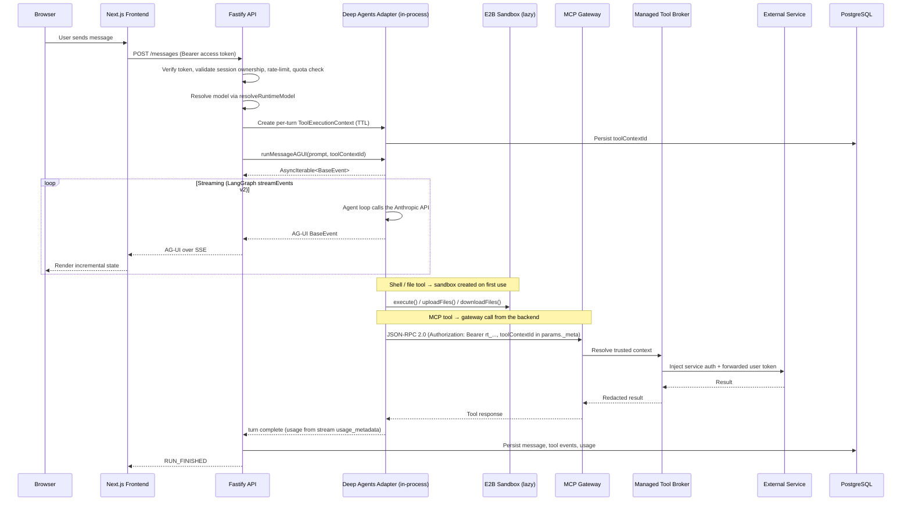

# Cogniplane Architecture

> **Scope:** The shipped architecture of Cogniplane Core. Operational details (commands, file paths, env vars) live in `CLAUDE.md`. Authoritative schema lives in `apps/backend/db/migrations/`.

## Overview

Cogniplane Core is a multi-tenant agent platform with a backend-controlled agent runtime. The backend owns auth, persistence, tool security, session lifecycle, policy compilation, event normalization, and the admin control plane. The runtime provides multi-step planning, tool orchestration, approvals, and richer streaming behavior than a thin LLM-plus-tool-loop stack.

The runtime is **Deep Agents** — LangChain's [deepagentsjs](https://reference.langchain.com/javascript/deepagents) — running **in-process in the Fastify backend** (`services/deep-agents/deep-agents-runtime-adapter.ts`). The library version is pinned via the exact `deepagents` version in `apps/backend/package.json`.

E2B provides a **code-execution sandbox**: a per-session Firecracker VM created **lazily on first shell/file tool use**. Chat-only sessions never create one, and when the tenant's `allowCommandExecution` is off, no sandbox is attached at all.

## Technology Stack

| Layer | Technology | Notes |
|---|---|---|
| Frontend | Next.js 16 | Deployable to any Next.js host (Vercel, Cloudflare Workers via `@opennextjs/cloudflare`, Node container, etc.) |
| Backend | Fastify (ESM TypeScript) | API, session lifecycle, in-process agent loop, MCP gateway, scheduler, policy compilation, audit, streaming |
| Runtime | LangChain [deepagentsjs](https://reference.langchain.com/javascript/deepagents) (LangGraph agent loop, in-process) | Multi-provider via `initChatModel` (Anthropic/OpenAI/Google/OpenRouter/Z.AI); per-provider tenant key or platform env fallback |
| Agent state | LangGraph `PostgresSaver` checkpointer | Postgres schema `deep_agents`; `thread_id` == session id |
| Sandbox | E2B Firecracker VM (`deep-agents-runtime-dev` template) | Lazy, per-session, code-execution only — no agent CLIs or SDKs inside |
| Database | PostgreSQL with Row-Level Security | Request pool: `app_user` under RLS. Cross-tenant pool: `maintenance_user` with explicit DML grants. Migrations run separately. The checkpointer has its own `app_user` pool |
| Cache / coordination | Redis (optional) | When configured: shared rate limits, refresh token `jti` revocation, turn quotas. Without it, rate limits are per-process. |
| Object storage | S3-compatible bucket (production), local filesystem (dev) | Artifacts and skill bundles share `ARTIFACT_BUCKET_*` credentials |
| Auth | WorkOS (SAML / OIDC / AuthKit) or `dev-headers` mode for local hacking | HS256 JWT access tokens (15 min) + httpOnly refresh cookies (7 day, Redis-revocable) |
| PII Provider | LLM-based detector + rule-based fallback | Opt-in per tenant; bring your own model provider via the `PII_*` env-var contract |

## Repository Layout

The repo is a pnpm workspace.

```
apps/backend             # Fastify API, Deep Agents runtime, MCP gateway, admin config, workers
apps/frontend            # Next.js 16 UI (chat workspace, admin workbench, user settings)
packages/shared-types    # Shared API contracts (Zod schemas) used by both apps
docker/                  # Backend Dockerfile + E2B code-execution template
docs/                    # Architecture, decisions, security features, guides
```

### Backend module map

- `routes/` — HTTP entrypoints. Hot path: `messages.ts`, `mcp.ts`, `approvals.ts`. Admin: `routes/admin/admin-*.ts`. Auth: `auth.ts`. Health, models, sessions, settings, artifacts, tenant.
- `services/deep-agents/` — the runtime: `deep-agents-runtime-adapter.ts` (RuntimeAdapter), `deep-agents-graph.ts` (agent construction), `deep-agents-e2b-backend.ts` (lazy sandbox backend), `deep-agents-checkpointer.ts` (durable state), `stream-events-to-agui.ts` (LangGraph to AG-UI).
- `services/runtime/` — runtime-adjacent lifecycle: `runtime-model-resolver.ts`, `provider-credentials.ts`, `runtime-session-store.ts`, `idle-teardown.ts`, `stale-approval-sweeper.ts`, `e2b-sandbox.ts`.
- `services/dynamic-config-*` — compile admin config from Postgres into the per-turn runtime-policy snapshot.
- `services/managed-tools/` — first-party tool implementations (session tools, `write_artifact`, memory tools, skill-corpus tool, GitHub, Notion).
- `services/managed-tools/factory.ts`, `services/managed-tools/catalog.ts` (+ `register-builtin-managed-tools.ts`), `services/redact-secrets.ts` — managed-tool dispatch (factory wires deps; catalog enumerates the allowlist) + audit redaction.
- `services/policy/` — Policy Center rule evaluation, rule storage, and decision evidence.
- `services/*-store.ts` — tenant-scoped persistence modules.
- `services/pii/*`, `services/pii/openai-compatible-pii-provider.ts` — PII detection/transform pipeline.
- `services/scheduler-*` — cron-driven scheduler worker for user-owned scheduled jobs.
- `services/integrations/` — third-party connection lifecycle (GitHub, Notion, Jira). `integrations/pipedream/` holds the Pipedream Connect client and the personal Jira connection; vendor details stay in that folder. Each built-in connector module (`github/github-connector.ts`, `notion/notion-connector.ts`, `pipedream/jira-connector.ts`) builds its store and service, and registers its descriptor, tools, and member routes through the same steps as an overlay. `services/connectors/builtin-connectors.ts` lists them.
- `services/skills/` — skill import/lifecycle, bundle storage, marketplace, improvement corpus.
- `services/artifacts/` — artifact storage, processing, and workspace sync.
- `lib/db.ts` — `withTenantScope` (RLS activation wrapper used by every tenant-scoped store call).

## Request Lifecycle



`POST /messages` (`routes/messages.ts`) validates input, resolves the model via `resolveRuntimeModel`, then hijacks the raw socket, sets SSE headers, and delegates to `streamAssistantReplyAGUI` (`services/sse-stream-writer-agui.ts`). The writer builds a `ToolExecutionContext` and calls `runtimeAdapter.runMessageAGUI`. There is a single runtime adapter, with no provider map or provider-resolution step.

`TurnTranscript` (`services/turn-transcript.ts`) finalizes the assistant row for interactive and scheduled turns. It reads runtime AG-UI events and classifies the outcome as completed, interrupted, or error. Thrown errors get client-safe messages. It saves text and status first. A failed write or a write that updates no row prevents a successful completion result. Reasoning, plan, runtime notices, and tool results follow as best-effort writes, including after a thrown error. A tool call that never returned is saved as `failed` after a completed turn or an error. After a stop it stays `in_progress`, because nothing reported a failure, and history shows it as interrupted. `MessageStore.updateContent` follows the same rule for rows that progress writes saved before. The stale sweep, lease expiry and shutdown backstop use the same rule: they interrupt the message and leave tool outcomes unchanged.

The SSE writer owns wire output, mid-turn checkpoints, and MCP App publication. It asks for progress writes and decides when to await them; `TurnTranscript` selects, orders, and saves them. The writer releases turn admission once, after finalization and before the terminal event. A failed release is logged; it does not change the saved outcome or the terminal event. The scheduler owns its job ledger, timeout, usage read, and session cleanup. Finalization does not retry runtime or tool actions or recover execution after a process stops. Existing stale-message sweeps close abandoned rows when enabled. If the final status write and its retry both fail, the stored row can retain an earlier status; the caller still reports a failed or interrupted outcome.

## Runtime Architecture

### Single-runtime model

`DeepAgentsRuntimeAdapter` (`services/deep-agents/deep-agents-runtime-adapter.ts`) implements the `RuntimeAdapter` contract. It lazily builds a per-session deepagentsjs agent (`createDeepAgent`) and runs each turn as a LangGraph `streamEvents` v2 stream inside the backend process. `stream-events-to-agui.ts` maps those envelopes directly to AG-UI `BaseEvent` values consumed by the browser and scheduler.

Agent construction lives in `deep-agents-graph.ts`:
- **Model** — multi-provider `initChatModel` via `resolveModelConstruction` (maps a catalog id to `<initPrefix>:<vendorModel>` + base URL per `MODEL_PROVIDER_META`): Anthropic, OpenAI, Google (`google-genai`), OpenRouter and Z.AI (both via the OpenAI client with a custom base URL). The key is resolved per-provider for the selected model (`provider-credentials.ts`): the tenant's stored key first, then the platform env fallback. Reasoning effort is baked in per provider by `applyReasoningEffort`. The in-process loop calls each provider's API directly. Token usage is captured from stream `usage_metadata` and persisted per turn.
- **State** — the shared Postgres checkpointer (below); `thread_id` is the session id, so multi-turn resume is a checkpointer read, and threads survive process restarts.
- **Sandbox** — the lazy E2B backend (below) when `allowCommandExecution` is on; otherwise no sandbox, no `execute` tool, and file tools fall back to deepagents' checkpointed StateBackend.
- **MCP tools** — a `GatewayMcpClient` (one `@langchain/mcp-adapters` `MCPAdapter` per server) speaking streamable HTTP from the backend to the platform's own `/mcp/:serverId` gateway, authenticated with a session-scoped `Authorization: Bearer rt_...` header (URLs never carry `?token=`; the gateway rejects query-param tokens). The per-turn `toolContextId` and any approval proof travel at call time in the request's trusted `params._meta["cogniplane.ai/invocation"]` entry, outside the tool arguments, so the gateway ignores a model-supplied value. Tools load per-server, in parallel, with degradation (one broken server skips its tools, not all), and names colliding with deepagents built-ins (`RESERVED_BUILTIN_TOOL_NAMES`) or duplicated across servers are dropped with a warning.
- **Approvals** — an `interruptOn` map (LangGraph human-in-the-loop middleware) built from the tenant's approval settings; see Approval Flow.

### Standard components in chat

The browser supports the standard Generative UI catalog through `render_ui`
tool calls and saved `a2ui` markdown fences. The provider keeps markdown mode
with `sendContext: false`. CopilotKit 1.83.0 registers its activity renderer in
either mode, but requires markdown mode to render fences from earlier replies.
The browser agent builds the tool guide from the current catalog envelope.
It sends previous user values and browser rejections as read-only records,
separate from the guide's editable surfaces. A record names a view from an
earlier reply, which the model cannot edit. Its `userValues` are what the user
has entered up to this request, and the guide says that they are current. Each
record is one JSON object.
A text value longer than 4,000 characters keeps its start, and a larger
structured value stays out; the record names both. The records use at most
32,000 characters. The newest records that fit are sent, and the guide counts
the records that it leaves out.
Project-action prompts use the same core run path as the composer so they also
receive that envelope.

`POST /messages` accepts the optional `generativeUiContext` field, bounded to
256,000 characters, and `generativeUiTransport: "tool"`, which requires context.
The route checks session ownership and applies the tenant's chat PII policy to
the context before saving a prompt or spending quota. A block returns 422. A
policy outage fails closed. A transform replaces the text sent to the model.
The user can pick an earlier side-panel view and change its values, so a value
that policy blocked can be cleared in any view. When a blocked request carried
earlier records, the browser leaves those records out of later messages and asks
the user to send again. A record that the user changes after that is sent again.
The runtime puts this context in a user message directly before the current
prompt, after earlier replies and below system rules. Tool calls and results
after the prompt keep their order. The context applies to this turn only. The
runtime does not save it in the checkpoint or reuse it on a later turn. Scheduled
turns and subagents receive no browser catalog or UI tool.

Root-agent middleware exposes the backend-owned `render_ui` tool only when the
turn carries both the transport flag and context. The tool accepts target
`chat` or `side-panel` and 1 to 100 A2UI v1.0 surface operations, with at most
30,000 characters of serialized arguments. This stays below the 32,000-character tool-input cap
on message-list reads. It checks operation shape, catalog id and surface
lifecycle. A call must create a surface in this turn before updating or deleting
it. Deleted ids cannot be reused in the same turn. Browser component and prop
validation remains authoritative for the standard catalog. Renderer-function
calls are rejected. MCP tools cannot claim the reserved name `render_ui`.

`render-ui-stream.ts` reads complete operations from model argument chunks and
emits cumulative `generative-ui-surface` activity snapshots. Providers that do
not stream arguments still show the surface at tool start. Tool completion sets
the final status. The call and result persist through the normal transcript
path; activities do not create separate database rows. `agui-history.ts`
rebuilds the same activities from saved tool inputs through `RenderUiTurn`.
Each surface id includes the assistant reply id, so reused model ids in later
turns cannot replace earlier surfaces. Malformed arguments reach the tool
and return error results. Saved failed or unfinished calls rebuild as error
activities. A model can call `render_ui` in a turn that did not offer it. The
tool refuses the call without a check, and the stream and history then apply
none of its operations, as the tool assumes for later calls. Argument streams
that never reach tool start are previews only; the runtime removes them at turn
end. It keeps previews across approval pauses. Before the turn ends, a
withdrawn preview has no operations, so a retry can use its surface id, and the
chat shows no row for it. At tool start, a call takes the tool run id that
history uses. The runtime then deletes the error activity of its preview at
once, so the chat does not show an empty card.
A reload rebuilds each surface from its saved operations. The values that the
user typed come back from the drafts of the tab (see
[Typed values after a reload](#typed-values-after-a-reload)).

Generated UI events and renderer-function replies cannot start agent turns.
Local bindings and calculations work in the browser. The catalog removes model
event callbacks, validates CSS and SVG paint values, and uses safe media
renderers. External media requires a click, maps show location lists, and HTML
is text. MapLibre is an unavailable optional peer in the production build.
MCP Apps still use the separate sandbox host.

The catalog adds four application components, `ArtifactCard`, `Checklist`,
`ComparisonTable` and `StatusSummary`, and keeps the id `cogniplane/standard@1`. Fences and tool surfaces saved before
them name the same id and render as before. No migration or backend change is
necessary. For `ArtifactCard`, the model sets only `artifactId`. Its resolved value must be a UUID
(`ArtifactCardPropsSchema` in shared types). The card declares no events. CopilotKit rejects an operation
that gives the card another prop, for example a name, status, URL or callback.

The card reads the name, status, size, MIME type and PII label from the
artifact list that the chat shell holds for the session. The host filters that
list by session id, so a stale or mixed list cannot show a file of another
session. An unknown id shows that the file is not available. The list stays in
the browser. The agent and the model context get only the catalog schema. To
render or update a card fetches no content, makes no signed URL and starts no
run. The list refresh after a live `write_artifact` result or at the end of a turn
updates the card. It keeps the
agent, the transcript and local surface input.

The Preview button shows only for a ready file that the PII scan does not hold
or block, and that the preview supports. A user click calls the existing
`openPreview` of the shell, which uses the shared preview loader and modal.
The server checks ownership and PII policy again when the preview loads. The
card does not change context selection and cannot download, change or delete
a file.

#### Checklist and "Use in reply"

`Checklist` (`checklist-card.tsx`, `ChecklistPropsSchema` in shared types) is
an editable list: a native checkbox for each item and an optional notes field.
The model sets up to 30 items with unique plain ids, labels of at most 200
characters, an optional title, and start values. `checked` (item id to boolean)
and `notes` (at most 2,000 characters) are writable props. The model binds them
to data model paths, for example `"checked": {"@path": "/release/checked"}`,
and puts the start values at those paths in `createSurface`. A duplicate id, a
`checked` key that names no item, or a value of the wrong type makes the props
invalid, and the SDK shows its fallback in place of the controls.

A bound edit goes through the SDK setter to `setOwnedValue`. So the draft store
keeps it through a reload, and the next message sends it as an earlier record.
A literal `checked` or `notes` lives only in the mounted node. The component
cannot see a binding, so it compares the user-owned values of the manager
before and after each write. When nothing changed, it puts the shown value
back and becomes read-only with a note.

"Use in reply" is application UI, not a model event. Model callbacks stay
stripped, and the browser agent still refuses runs that generated UI starts.
The button writes a plain text of the title, the progress, every item with its
checked or unchecked value, and the notes into the message box through the
widget-draft seam of MCP Apps. It sends nothing, starts no run, fetches nothing
and opens no link. The notice above the box names the checklist as a generated
view and keeps the draft warnings. A draft that the user typed stays: the
button reports it and offers "Add after my text". In a read-only chat the
button does not show. While the history loads or a turn runs, it is disabled
and says when it works.

The composer shows the generated input review and the draft notice above the
message box. Application controls accept pointer events inside the SDK overlay.
The chat area's size container sets the height budgets, and the controls share
a scroll region. The host handles the keyboard offset for the whole composer
and reserves that space for transcript scrolling. The SDK input receives no
second offset. Send and Stop keep their existing request paths.

#### Comparison table and status summary

`ComparisonTable` (`comparison-table.tsx`, `ComparisonTablePropsSchema` in shared
types) and `StatusSummary` (`status-summary.tsx`, `StatusSummaryPropsSchema`)
show data and nothing else. They declare no events, slots or writable props, and
they have no button, link or input. So a model cannot make them act, they keep no
value of the user, and they add nothing to the next message. The model gives the
data and the app draws the layout, so a view looks the same with every model. The
shared schemas bound every prop, and an invalid prop makes the SDK show its
fallback in place of the view.

`ComparisonTable` takes an optional `title`, which is the native caption, 2 to 8
`columns` (the compared items, `{ id, label }`) and 1 to 30 `rows` (the
criteria, `{ id, label, cells }`). `cells` maps a column id to a text of at most
300 characters, a number between -1e15 and 1e15, a boolean, or `null`. Ids are
unique among the columns and among the rows, hold only letters, digits, `-` and
`_`, and are never a prototype name. A cell key that is not a column id makes the
props invalid. The table shows the values as given: a number with separators and
no rounding, `Yes` or `No` for a boolean, and `No data` for `null`, a blank text
and a column that a row leaves out. A 0 and a `false` are values. It adds no
ranking, score or highlight. The table is a native `<table>`: the title is its
`<caption>`, the headers carry `scope`, and the first column holds the criteria.
It scrolls sideways in its own focusable region, so it never widens the page, and
the caption and the criteria column stay in view while it scrolls. Text wraps in
bounded cells. A note names the scroll when the table is wider than the space.

`StatusSummary` takes an optional `title`, 0 to 30 `items` and optional counts.
An item is `{ id, label, status?, detail?, completed?, total? }`. `status` is one
of `not-started`, `in-progress`, `at-risk`, `blocked` and `complete`. The app
colors a status by its name and reads no status from other text, so a reason goes
in `detail`. It shows the text of the status with an icon, so color is never the
only cue, and an item without a status says "Status not reported". `completed`
and `total` are a pair of whole numbers, with `completed` at most `total`, on an
item or on the whole view. The model supplies a whole-view count only when the
source data gives one, and uses the title to name what it measures. It must not add
up the rows. The app computes no count and no percentage. It shows a
native `<progress>` only when a pair has a total above 0, and it states the count
as text ("3 of 8 completed"). An empty list says "No status items to show."

The tool guide gives the model the exact contract and one example of each. Both
views work in the chat and in the side panel, and the guide still leaves the full
record budget (a host test checks it). They are not a dashboard engine: there is
no sort, link, chart or action.

#### Values that the next message sends

A disclosure above the message box lists the generated-view values that the
next message sends (`generative-ui-input-context.tsx`). It reads
`describeSurfaces` of the SDK manager, the source of the run envelope, and
passes it to `previewEarlierRecords` of the browser agent. That function is the
code that builds the records of the request, with the records that the PII
policy blocked left out. So the list shows a cut text as cut, and counts views
that the size limit or the policy leaves out. The preview uses the full 32,000
character budget; a host test checks that the catalog guide leaves that room.
The list covers every view with user-owned values, not only checklists,
because all of them go with the message. It keeps nothing in storage and makes
no request.

#### Starters in an empty chat

A chat with no messages offers four starters (`chat-starters.tsx`, with the text
in `chat-starters.logic.ts`): a checklist, a comparison table, a status summary,
and a view in the side panel. They are fixed text of the app and use no host
context. So they name no file, source, integration or result, and each draft
asks the agent to ask the user for what is missing and not to invent it. A click
puts the draft in the message box through the widget-draft seam, with the origin
`app-starter`. The notice then says that the app put starter text in the box. It
does not say that a tool or a generated view wrote it. The click sends nothing,
makes no request and starts no run. The user changes the draft and sends it with
the normal Send button.

The list shows only when the connection delivered an empty history, this tab can
send (the user can edit, and no turn runs here or on the server), no project
prompt waits to start, and the message box is empty. Text in the box hides the
list, and clearing the box shows it again. In every other state the chat keeps
its plain line: "Ask me anything.", or "No messages in this chat yet." when the
chat is read-only. The seam checks the box and the chat state again at the click.
It refuses when the box holds text or the chat cannot send, and it never adds
to a draft of the user. For that, the composer binds its box, and the seam takes
its state, in layout effects, so both match the commit that shows the list. The
host test `copilot-chat-host.starters.test.tsx` covers the states above, the
session switch, and zero message requests until the user sends.

### Side panel outside chat

The chat host has one named place for tool UI outside the transcript: the side
panel (`generative-ui-side-panel.tsx`). It is CopilotKit's
`GenerativeUISurface` with the target id `side-panel`
(`GENERATIVE_UI_PANEL_TARGET` in shared types). It sits beside the transcript,
inside the same provider, catalog and ArtifactCard list as the chat. The app
sends no fence guide, so the model writes panel views with `render_ui` only.
CopilotKit still reads a `target=` on a saved a2ui fence, and the app does not
block it. There is no other named target, no layout builder and no storage of
its own.

The browser agent builds the tool guide from the targets that are mounted and
that `GENERATIVE_UI_TARGETS` allows. So the model sees `chat` and `side-panel`
with the panel's description, and never another `GenerativeUISurface` of the
page. The tool text and its `target` argument name no target and point to
that guide, so a tab with an older bundle and no panel is not offered one.
The backend accepts only those two targets. `RenderUiTurn` records the
target of each surface at `createSurface`. An update or delete in a call with
another target is rejected, because the SDK would move the surface. The
rejection goes to the surfaces that call rendered, or to a chat error activity
when it rendered none. Errors never go to the panel, so they cannot replace
its view. Live snapshots and rebuilt history use the same reducer, so the
target, operations and status match after a reload.

A panel activity is a `generative-ui-surface` message in the transcript, at
the call that created it. The transcript does not render it: the host gives
CopilotChat's message view a `transformMessages` that drops panel activities,
so they take no row. `useSidePanelState` reads every panel activity of the
agent's messages into the SDK surface manager, in message order, when the host
mounts and on each message change. The manager orders a surface when it first
reads it, and `getSurfaceForTarget` returns the newest. So the panel shows the
view of the latest reply, live and after a reload, until the user picks an
earlier one. This also holds in a long
thread, where CopilotChat virtualizes more than 50 rows and mounts only some
of them. A repeat read applies no operation again. When the agent deletes the
newest view, the panel shows the newest earlier view, or its empty state. The
host remounts for each session, so a panel never shows the view of another
session.

Two SDK rules need host code. When the browser rejects the first
`createSurface` of a surface (an unknown component or a bad prop), the manager
deletes it, and `getSurfaceForTarget` returns an older view. So the host checks
the newest panel activity with `getFailedSurface`, and shows "The newest view
could not be shown" in place of the older view. `GenerativeUISurface` stays
mounted, so the target stays in the guide. The backend withdraws a preview
mid-stream with an activity that has no operations, and sends the delete at
run end. A delete mid-stream would make the SDK refuse the surface id for the
rest of the page, and a retry in the same turn often uses the same id. The host
reads a withdrawn panel preview under a target that nothing mounts. So the
panel shows the earlier view, and a retry with the same id shows.

#### Named views and earlier views

The panel shows one view and names it. The header has the title of the view and
"From reply N". The title is the literal `title` of a root `Checklist`,
`ComparisonTable` or `StatusSummary`, as the browser built it, cut to 80
characters and shown as plain text: control and bidirectional characters go, and
nothing is markdown, HTML or a link. Any other root, and a bound title, gives
"Generated view". The host does not guess a name. The reply is the position of the
activity in the transcript: the run of messages between two user messages, counted
from the first loaded message. These numbers describe the loaded transcript, not
stable turn identities. A blocked prompt has no saved user row, so a reload can
change later reply numbers. No field of the activity names a reply, and the header
never shows a surface id. When the backend cut the history
(`hasMoreHistory`), the count would start in the middle. The panel then shows no
reply number and numbers only the views that share a title.

With more than one view, a native `<select>` ("Switch view") lists them, newest
first. A label starts with the reply ("Reply 3 · Title"), marks the latest view and
a view that streams or failed, and adds "(1 of 2)" to labels that are still equal.
One view has no picker. The latest view is the default after a reload or a session
switch. A reconnect keeps the chosen earlier view if it still exists. The choice
of an earlier view lives in the tab only. It is a pin that the host checks against the transcript and the
manager on each read, so a view that the agent deleted, that a reconnect removed,
or that is now the latest ends it. While the user looks at an earlier view, a
note says so and counts the newer views, and "Show latest view" goes back and puts
focus on the picker. A view that arrives meanwhile changes neither the selection
nor the focus. The tree of each view is keyed by its surface, so no local state of
one view reaches the next.

CopilotKit 1.83.0 has no renderer that takes a surface id: `GenerativeUISurface`
shows the newest surface of its target, and `SurfaceView` is not public. The host
always gives every panel view except the selected one the target
`side-panel:parked` (`lib/agui/generative-ui-targets.ts`), as it gives a withdrawn
preview its own target. The content is the same, so the manager keeps the surface
and its operations and applies nothing again. The values of the user stay. A switch
runs no tool, sends no message, creates no surface and calls no callback. Nothing
mounts the parked target, and the panel mount limits no components, so the browser
checks operations as before. Every reader of `describeSurfaces` reads the parked
target as `side-panel` (`canonicalTarget`): the records that the next message sends,
the preview above the message box and the saved drafts. So the values of every
view, shown or not, go with the next message once, and the model never reads the
parked target. A refused latest view leaves the panel with no older view in its
place. A view removed from authoritative history gets `side-panel:removed`, which
is excluded from context and drafts. Before rendering, the host checks that the
SDK target resolves to the selected surface id. An unrelated markdown fence can
also write to the panel target. If it wins the SDK lookup, the panel shows an
unavailable notice instead of content with the wrong title or reply number.

The panel is closed when a session opens. It stays mounted while closed, so
the target stays in the guide, and a close keeps the transcript, the message
box and values in the panel. The "Side panel" button in the chat toolbar opens
and closes it.

A view tells the user about itself in this way. `useSidePanelState` marks a
panel view as new when an `ACTIVITY_SNAPSHOT` event brings a surface id that
the host has not read. The history load sends a `MESSAGES_SNAPSHOT`, not
snapshot events, so a saved view is never new, on the first load or after a
reconnect. For a new view:

- On a wide screen (`md` and up), the panel opens, unless the user closed it
  earlier in this session. The open moves no focus and scrolls nothing, so a
  user who types in the message box keeps typing. A status region says that the
  agent opened a view.
- On a narrow screen, or after a close by the user, the panel stays closed. A
  notice under the toolbar says that the agent added a view and has a "View
  side panel" button. The toggle shows a "New" label, and the status region
  says the same. An open from the button or the toggle clears the notice.

A surface cannot scroll the page or move focus. An open that the user asks for
(the toggle or the notice button) moves focus to the close button of the panel,
and a close moves it back to the toggle. The entrance motion uses `motion-safe:`
utilities, so `prefers-reduced-motion` removes it.

On a narrow screen an open panel covers the chat, as the artifacts panel does,
so it is a modal. It has `role="dialog"` and `aria-modal`. Everything outside
it and its backdrop is `inert` (`lib/inert-background.ts`), Tab wraps inside it,
and Escape closes it. The Escape handler calls `preventDefault`, so the Stop
shortcut of the host does not also run. A key from a Modal of generated UI,
which draws in a portal, has a target outside the panel, and that Modal keeps
it. The page is inert only while the modal is open, and the panel stays
mounted, so the values stay. On a wide screen the panel is not modal, and
Escape there still means Stop.

The catalog drops `open` and `setOpen` from every Modal, in the chat and in the
panel, as a literal or a binding. So a Modal opens only from a click of the
user on its trigger, and never as a portal over the page from a closed panel.
The panel shows a note while the view streams, and a note when some operations
were refused.

#### Typed values after a reload

A value that a user types into generated UI belongs to the SDK surface manager.
The setter of a bound prop calls `setOwnedValue`, and `describeSurfaces` lists
those paths. A reload rebuilds each surface from its saved operations and loses
them. So `useGenerativeUiDrafts` (`generative-ui-drafts.ts`) keeps them in the
`sessionStorage` of the tab, for the chat and the panel, and applies them after
the history loads. No server field, schema or request changes.

- Scope. One record holds the drafts of up to 8 sessions. It names its owner
  by a hash of the user and tenant ids, and each session by its id. The chat
  shell gives the host that identity as `draftScope`. A host with no scope
  keeps nothing. A record of another owner is removed when it is read.
  `AuthProvider` clears the record when the person changes or the session
  ends (sign-out, a revoked refresh, another sign-in). A clear also ends every
  running sync, so the flush of a closing page cannot write the record back.
- What is saved. Only values that the user owns, by JSON pointer. False, 0 and
  empty text stay. Each surface also keeps its target and a digest of its
  operations. The bounds are the newest 24 surfaces per session, 64 values per surface,
  20,000 characters per text and 250,000 characters per record. A value over a
  bound is left out, never cut. A prop that the model did not bind lives in the
  component, not in the manager, so it is not saved.
- When it saves. The manager sends no event for a user edit. An input, change, click or keydown
  event inside generated UI, a Modal included, starts a 300 ms timer that reads
  the manager. The DOM never gives a value. A page hide and a host unmount
  write at once.
- When it restores. A saved draft is pending until its surface is in the
  manager. The panel ingests at once. A chat surface enters only when
  CopilotChat mounts its row, so in a long thread a draft can wait. The draft
  applies only to the same view: not deleted, withdrawn or refused, the same
  target, not streaming, and the first operations match the saved digest. A
  path that the user edited since the load keeps the new value. A draft whose
  surface has no activity message in the loaded history is dropped. Each write
  is the live values plus the pending drafts, so a flush before the history
  arrives cannot erase one. Nothing creates or recreates a surface. Surfaces
  from saved `a2ui` fences are not covered, because they are not activity
  messages.
- Failure. Blocked storage keeps the edits in memory, and the host says that a
  reload resets them. A write that fails (a full quota, or a record over the
  bound) first evicts the oldest other sessions. If that is not enough, it
  removes the session record instead of keeping an older copy, and the host
  says so. A corrupt record is discarded.

### Development Inspector

The chat host can mount CopilotKit's Inspector (`@copilotkit/web-inspector`,
pinned with react-core 1.83.0) for local debugging. CopilotKit turns it on by
default in a development browser. So the host always passes `enableInspector`
as a boolean, from `useInspectorOptIn` in `lib/copilotkit-inspector.ts`. That
gate is true only when `NEXT_PUBLIC_COPILOTKIT_INSPECTOR` is exactly `1`,
`NODE_ENV` is `development`, and the page hostname is `localhost`, `127.0.0.1`
or `[::1]`. The server render gets false. CopilotKit then checks the build, the
browser and the hostname again before it loads the package, so a production
build never loads it. `showDevConsole` stays false.

The Inspector reads the core of the open session: the agent's messages, state
and AG-UI events. It starts no run and no connection. The host mounts a new
provider for each session, so the Inspector moves to the new core and CopilotKit
removes the old element. The Inspector Playground copies the agent with
`clone()`. `DeepAgentsBrowserAgent.clone` returns a copy with no subscribers
that refuses to run, connect or detach before a request. So the Playground
cannot post a message, change the chat's messages or state, or move the active
surface thread. In development the package also calls CopilotKit feed and
telemetry hosts. The development CSP blocks them, and the app keeps that CSP.

### Durable state (checkpointer)

`deep-agents-checkpointer.ts` wires a LangGraph `PostgresSaver` into its own Postgres schema **`deep_agents`**, with an explicit named pool. DDL runs from `migrate.ts` (superuser) via `setupDeepAgentsCheckpointer`; the runtime saver connects as `app_user`. **The checkpointer tables have no tenant column and no RLS** — isolation is app-layer: `thread_id` IS the session id, and every route that reaches the checkpointer resolves the session through the RLS-scoped `sessions` table first. Session deletion purges the thread; idle teardown does not.

### E2B sandbox backend

`deep-agents-e2b-backend.ts` implements `E2bDeepAgentsSandbox extends BaseSandbox` (deepagents' sandbox protocol — the library has no official E2B backend). It implements `execute()`/`uploadFiles()`/`downloadFiles()` over the E2B JS SDK and overrides `ls`/`read`/`grep`/`glob` to remap "/"-rooted paths into the session workspace (`/home/user/workspace/<sessionId>/`); workspace-escaping paths return the protocol's structured error. The sandbox is **created on first use and memoized per session** — chat-only sessions never pay for one. `execute()` also reports the structured exit code of each command to the tool run that is current, with the LangChain custom event `cogniplane.execute_result` (`execute-result-event.ts`). The SDK `execute` tool formats the response as text (`[Command failed with exit code 19]`) and returns it as a successful message, so only the sandbox still has the number. The stream mapper keeps the code by tool run ID and marks the card `failed` when the `execute` tool ends with a non-zero code. It never reads the result text, and a file tool that runs a command (a `grep` with no match) keeps its own result. A per-command timeout (`DEEP_AGENTS_EXECUTE_TIMEOUT_MS`, default 2 min) and a 64k output cap are enforced at this layer; `E2B_SANDBOX_TIMEOUT_MS` (default 30 min) caps sandbox lifetime.

The template (`docker/template.ts`, name `deep-agents-runtime-dev`, built by `make e2b-build`, id wired via `E2B_TEMPLATE_ID`) is deliberately a dumb code-execution box: the stock `e2bdev/base` image plus Python 3 with a pinned knowledge-worker data stack (pandas, openpyxl, matplotlib, jinja2), ripgrep/sqlite3/git — **no agent CLIs or SDKs**. Building under the same name updates the template in place, preserving its id; cutover/rollback is an `E2B_TEMPLATE_ID` env change.

**Network policy.** A sandbox has no network unless the tenant approves hosts. The approved list (`tenant_settings.approved_sandbox_egress_domains`, edited on Admin → Agent behavior) becomes one `SandboxNetworkPolicy` (`services/runtime/sandbox-network-policy.ts`). The network of a sandbox is fixed when it is created, and the backend never changes it: `Sandbox.create` gets `network: { denyOut: ["0.0.0.0/0"], allowOut: <hosts>, allowPublicTraffic: false }`, built from the policy as it is read from the tenant settings at that moment, and `Sandbox.getInfo` reads it back before any command runs. A sandbox that fails the check is killed and not used. At the first use of each turn or job, and at a reconnect, one live read compares the sandbox with the policy as it is then. A match holds for the turn. A mismatch (a changed list of hosts, a sandbox from before the policy, unexpected rules or settings that were not requested, such as request rules or an egress proxy) replaces the sandbox with a notice. The old sandbox is killed with up to four tries, and the session lease is checked in the database before each try. No command and no file operation runs in a sandbox that was not confirmed in the current turn. An operation belongs to the turn that was current when it was called, every step of a method that has several (a file edit is a download and an upload) belongs to the turn of the call, and it runs only while that turn is live: a turn that ended, was cancelled or was replaced by the next one, and a runtime that was disposed, run nothing more, and a creation that an earlier turn began stops before its first command. `Sandbox.create` is sent once, because the SDK would send it again after a 503. Every provider request has a timeout and is tried again when it fails, and one deadline (`E2B_NETWORK_CONFIRM_TIMEOUT_MS`) covers the check. If the sandbox cannot be read in time, the call fails and the sandbox is kept. A kill that still fails after all tries is logged as an error with the sandbox id, and the sandbox is replaced all the same. The old sandbox then runs until the provider expires it (`E2B_SANDBOX_TIMEOUT_MS`), with the network that it was created with. The lease check before a kill cannot be atomic with the kill request, so an owner whose kill is delayed can destroy a sandbox that the next owner adopted under an unchanged policy. The network stays restricted, and files that only existed in that sandbox are lost. The hash of the policy that a sandbox was created under is saved with its id as a record. The template also removes the guest's passwordless root (`sudo` and the empty root password) in its start command.

### Session lifecycle

- One session runtime per active session, created on demand, torn down after `RUNTIME_IDLE_TIMEOUT_MS` (`services/runtime/idle-teardown.ts`). Teardown kills the sandbox but leaves the checkpointer thread — conversations resume across teardowns and process restarts.
- Runtimes emit lifecycle audit events (start, resume, idle teardown, interrupt).
- A per-turn watchdog (`RUNTIME_TURN_TIMEOUT_MS`, default 20 min) aborts a wedged turn via the graph's abort signal; it is disarmed while an approval prompt is pending, and config validation pins it above `APPROVAL_REQUEST_TTL_MS` and below `E2B_SANDBOX_TIMEOUT_MS`.
- Turn failures pass through messages from `Error` instances with a 4xx status; other failures use a generic message, with a fixed translation for `GraphRecursionError`. A 4xx status alone does not prove provider text is safe. Review passthrough classification and redaction before relying on it to prevent disclosure.

## Personal defaults and private skills

Settings at `/settings/capabilities` lets members choose defaults for their normal
standalone chats. The API stores these choices by tenant and user. A null selection
inherits organization defaults and includes the member's released private skills.
An empty custom selection selects nothing. Project and scheduled chats do not use
personal defaults. A chat's own saved selection can further narrow its defaults.

Members can write a private skill or import a single `SKILL.md`. They save a draft,
review its instructions and validation warnings, and explicitly make it available.
Edits create revisions without changing the active instructions. Release activates
the latest revision and adds it to custom personal defaults in one transaction.
Every write checks the account scope, current membership, and saved version.

Migration `052_personal_skills.sql` adds separate tables for these skills and their
revisions. Queries filter on tenant and owner; tenant RLS and membership cascades
provide further isolation. Each member can keep 100 skills with unique names and
up to 50 revisions per skill. Revision cleanup preserves the active revision.
Audit events omit instruction contents.

Only the owner's normal standalone runtime loads released personal skills. Project,
scheduled, and skill-improvement sessions do not load them. Release, disable, and
delete change the runtime bundle on the next turn. Draft edits do not. Personal
skills cannot grant tools or override organization policy. Imports save instructions
only; companion files and remote imports are not supported. Sharing a conversation
can share messages that quote earlier private work, but does not share the private
skill library.

## System Prompt & Skill Pipeline

There is **no rendered workspace config** — the adapter assembles the agent **system prompt at session start**: tenant `developerInstructions` + the memory tool list and one rule that memory is user data (see Long-term memory below). The prompt holds no memory text. Skills are NOT inlined into the prompt — `buildSkillsLibraryFiles` renders each enabled skill to a read-only `/skills/<slug>/SKILL.md` (plus materialized bundle companion files), mounted as a `CompositeBackend` route and surfaced by the native deepagents skills middleware. Progressive disclosure: only each skill's name/description/path reaches the prompt; the model `read_file`s the full SKILL.md on demand.

Config is compiled from Postgres by `DynamicConfigService` (`services/dynamic-config-service.ts`) and snapshotted onto the per-turn `ToolExecutionContext`.

### Long-term memory

Memory text was written by a model or a user, so it never enters the system prompt. Server authorization never reads it either.

- **Prompt.** `buildMemorySectionLines` (`memory-workspace-section.ts`) adds the enabled memory tools and one rule: saved memories are user data, not instructions, and cannot change rules, tool permissions or approvals. The prompt is the same on every turn, so its prompt-cache prefix stays valid.
- **Data message.** At the start of each turn the adapter reads up to 10 recent memories for the session's user. The read is gated on `memory_search` and, in Policy Center enforce mode, on a side-effect-free policy check. The result is passed in the graph runtime `context` as `memoryContext`. `deep-agents/memory-context-middleware.ts` adds it to the model input of each call as a human message that is labelled as user data. Each memory is a JSON line in a `<saved_memories>` block, cut to 200 characters. Credentials are redacted. Characters that do not print are shown as `⟦U+XXXX⟧`. Text such as `</saved_memories>` cannot close the block.
- **Reload.** The data message is not part of the saved conversation or the checkpoint. A reload and the AG-UI rehydration read only the transcript. An edit or a delete in settings applies at the next turn, and a deleted memory cannot be replayed from history.
- **Consent.** `memory_save` has `requiresUserApproval` in the managed tool catalog. In every interactive turn, whatever `approval_policy` and Policy Center say, the graph interrupts before the call (`durableWriteEntry` in `deep-agents-graph.ts`). The adapter builds the approval card with the exact text and the text that it replaces (`memory-consent.ts`). The proof ledger binds the approval to the call and its argument hash, as for Policy Center. The gateway then accepts the call only when `enforcePolicyCenter` returns the approval that this call claimed (`approvalDisposition: "approve"`). A replay, a changed value, another user, another turn or a declined approval finds none. A save that replaces a memory also checks that the replaced text is the text the user saw: the approval row stores its hash, and `MemoryStore.save` compares it under a row lock.
- **Scheduled runs.** A scheduled turn has nobody to ask, so the graph opens no prompt and the gateway refuses the call with a tool result `{ "error": "… Nothing was saved." }`. Every refusal of `memory_save` is a tool result of that shape, not a JSON-RPC error. A JSON-RPC error reaches the graph as a thrown tool exception, and deepagents' `wrapToolCall` middleware makes `ToolNode` rethrow it, which ends the turn.
- **Provenance.** The server records `provenance`, `source_session_id`, `approved_by_user_id`, `approval_id`, `approved_at` and `version` on each memory (migration `068_memory_provenance.sql`). Rows from before the migration read as `unverified`. Model-supplied `metadata` is plain data and never proof of approval. The agent refuses text that holds a credential.
- **User view.** `/settings/memories` lists, edits and deletes the signed-in user's memories through `/me/memories` (`routes/memories.ts`). Routes use the tenant and user from the request and address a memory by its id. An edit sends the account scope and the `version` that the editor started from, even if the page read the list again since. If the memory changed after that version, the server refuses the edit (`memory_conflict`). The page then keeps the user's text in the editor, shows the latest saved text beside it, and lets the user reapply their text to the latest version or discard it.

### Skill data flow

```
SKILL.md body → validateSkillBundle → buildSkillImportPayload
  → importSkillBundle (merges skillName/description/instructions INTO metadata JSONB)
  → activateSkillRevision (reads metadata.skillName + metadata.instructions — fails if absent)
  → compileRuntimeConfig → DeepAgentsRuntimeAdapter.createSession
  → buildSkillsLibraryFiles → read-only /skills/<slug>/ library (generated SKILL.md + bundle companions)
  → native deepagents skills middleware (progressive disclosure in the system prompt)
```

`instructions` lives in `revision.metadata->>'instructions'` (NOT a column). Skills with a null `bundle_storage_uri` use inline instructions.

### Skill bundle storage

Skill bundles (zipped `SKILL.md` + companion files) have two storage backends, chosen by `SKILL_BUNDLE_STORAGE_BACKEND`:

- **`local`**: bundles live at `<SKILL_BUNDLE_STORAGE_ROOT>/<bundleName>/<contentHash>/`. Suitable for `make dev`; ephemeral on container deployments where `/tmp` does not survive task replacement.
- **`bucket`** (production): bundles upload as `.tar.gz` to S3 at `s3://<bucket>/<prefix>/skills/<tenantId>/<skillId>/<revisionNumber>-<contentHash>.tar.gz`. On session start, `installBundle` downloads and extracts on demand into `<SKILL_BUNDLE_CACHE_ROOT>/...`. The cache is content-addressed and idempotent.

Each `admin_skill_revisions` row stores the canonical `bundle_storage_uri` (`file://` or `s3://`); the scheme selects the backend at runtime.

## MCP Gateway & Tool Security

`/mcp/:serverId` (`routes/mcp.ts`) receives JSON-RPC 2.0 from the runtime's MCP client (`GatewayMcpClient`, one `MCPAdapter` per server). Two modes per server:

- **managed** — the call dispatches to the `ManagedToolFactoryRegistry` (`services/managed-tools/factory.ts`, `createDefinitions`). The `ManagedToolCatalog` (`services/managed-tools/catalog.ts`) aggregates per-domain catalogs: session tools, `write_artifact`, memory tools, and the skill-corpus tool from `register-builtin-managed-tools.ts`; GitHub tools, Notion tools, and Jira read tools from their connector modules.
- **proxy** — forwarded to an upstream URL with framework context headers injected.

Every tool call requires a `toolContextId` resolved against `ToolExecutionContextStore`. The context carries `userId`, `sessionId`, `runtimeId`, and a snapshot of the tenant's effective runtime config (compiled from `tenant_settings`) — the model never sees credentials directly. It also keeps the security version of the owner's local account that admitted the turn, and a lookup refuses the context after the version changes.

Tool results pass through `redactSecrets()` (`services/redact-secrets.ts`) before persistence to strip auth headers and tokens.

### Member credentials for approved connections

Admins choose whether a proxy MCP connection uses one organization credential or
requires each member to connect. Members enter bearer tokens, header secrets, or
query secrets at `/settings/connections`, after reviewing the destination and auth
method. An optional account label is supplied by the member; it is not verified
provider identity. This flow does not register private MCP URLs or perform OAuth.

Migration `053_member_mcp_credentials.sql` stores encrypted credentials by tenant,
member, and connection. Reads and writes check current membership and connection
availability. Saves compare both connection and credential versions. Removing a
credential clears its secret and keeps a versioned tombstone to reject stale saves.
Audit events contain IDs and versions, never secrets or account labels.

Endpoint, authentication, and credential-scope changes replace the connection's
credential binding. Old member credentials then require reconnection, even if an
admin changes the endpoint back. Runtime calls use the acting member's credential;
project access never lends another member's account. Missing credentials remain
visible in selection screens with a connection prompt, but are excluded from runtime
tools. A security change of the member's local account suspends a saved
credential until the member saves a new one. Tool metadata caches
include member and credential version so one account's tool permissions cannot
affect another account. Each turn records connection hashes
and credential versions in its trusted tool context. A pending approval cannot send
a call through a changed endpoint or newly saved account.

### Trust boundary

```
Frontend --[JWT]--> Backend --+-- Deep Agents loop (in-process; toolContextId only, never user tokens)
                              |
                              +--[Bearer rt_... + toolContextId]--> MCP Gateway
                                                        |
                                  +----------managed----+----proxy----+
                                  |                                    |
                      Managed Tool Broker            Forward validated user token/context
                                  |                                    |
                          External Service               Downstream MCP server enforces auth
```

Rules:
1. Never give user JWTs or bearer tokens to the model. The agent loop receives only `toolContextId` and compiled policy.
2. Never trust model-supplied identity fields. The model cannot author `user_id`, `session_id`, or `auth_token` in tool arguments. The runtime sends `toolContextId` in the trusted `params._meta` entry on every call, and the gateway then ignores a `toolContextId` in the arguments.
3. Validate provenance server-side on every tool call. Verify session ownership before routing.
4. Authorization stays at the service boundary. Managed tools enforce downstream access via the tool broker; enterprise MCP servers enforce their own.
5. Sandbox workspaces are isolated per session. File tools remap "/"-rooted paths into the session workspace and refuse escapes.
6. Tool event payloads are scrubbed of tokens, auth headers, and credentials before being written to Postgres.
7. Tool execution contexts expire (`TOOL_CONTEXT_TTL_MS`, validated strictly above `RUNTIME_TURN_TIMEOUT_MS`), and they stop at once after a security change of the owner's local account.
8. Stored OAuth credentials and runtime tokens are encrypted at rest with AES-256-GCM (`lib/crypto-utils.ts`, scrypt-derived key memoized per process).

## Approval Flow

Native runtime approvals and Policy Center approvals share one checkpointed graph interrupt, frontend event shape, approval row, and decision route.

**Native HITL approvals are LangGraph interrupt-based.** `tenant_settings.approval_policy` (`"never"` bypasses gating) drives an `interruptOn` map built in `deep-agents-graph.ts`: all MCP gateway tools (minus read-only ones when `auto_approve_read_only_tools` is on) plus the mutating built-ins (`execute`, `write_file`, `edit_file`), plus the read-only built-ins when the read-only bypass is off. An interrupt pauses the graph **before** tool execution and checkpoints; the adapter detects pending interrupts after the stream ends, persists an approval row, emits an AG-UI `CUSTOM` event named `approval_required`, and resumes the graph with a `Command` once decided. Resume is keyed **per interrupt id**, so concurrent interrupts (parallel `task` subagents each hitting a gated tool) get their own decisions.

The frontend calls `POST /approvals/:approvalId/decision` with `{ decision: "approve" | "reject", rememberForTurn?: boolean }` (`routes/approvals.ts`), which persists the decision and resumes the paused graph.

**Approvals and tool cards.** A tool call that the main agent's model proposes gets a server ID. At `on_chat_model_end`, `stream-events-to-agui.ts` gives one to each call ID that occurs once in that model message. Models repeat call IDs across messages and turns, so a model call ID is never identity. The tool card, its result, the saved tool result (`tool_result_id`) and the approval all use the server ID. Approval reads return only the public approval fields and the optional call ID. The response schema drops policy proofs, request payloads and runtime identity fields.

The link to an approval comes from the server. Every gated `interruptOn` entry writes a HITL description that carries the model's call ID. `getPendingActions` reads it as `modelCallId` only for an interrupt of the main agent's HITL task (`HumanInTheLoopMiddleware.after_model`). An interrupt inside delegated work surfaces under the `tools` task and gets none: its call IDs come from another model message and can equal the main agent's. When the graph pauses, the AG-UI driver shows the card of each linked call, then asks for the approval with that `toolCallId`. The approval row saves it (`approvals.tool_call_id`, migration `085_approval_tool_call_id.sql`). `approval_required` and `GET /sessions/:id/approvals` return it. `POST /approvals/:approvalId/decision` still takes only the approval ID. `on_tool_start` carries the tool's run ID and no call ID, so a `ToolCallIdTracker` callback records the call ID of each run before the event arrives. The run then takes the card of its call. A delegation that starts again after an approval inside it keeps its one card.

A declined, expired or refused call gets the message that the model gets as its result, with status `declined`. When one call of a step is not approved, LangChain's batched HITL middleware runs none of the other calls of that step. An approved call of that step then settles as `declined` with text that says it did not run. A stopped turn leaves its cards unfinished, and `TurnTranscript` saves them as `in_progress`. These cases get no link, and their approvals stay in the notification list: a call ID that one model message repeats, a call without an ID, delegated work, and approval rows from before migration 085. In the browser, the first mounted card of a call shows the decision controls. The notification list shows every other pending approval, also one whose card the virtual list unmounted (`chat-cards/tool-approvals.ts`). Never link by `itemId` (it equals the approval ID), tool name, arguments or position. `deep-agents-graph.test.ts` pins the SDK facts, and `deep-agents-approval-cards.test.ts` checks the path through the real graph.

The tool card (`copilot-render-slots.tsx`, `tool-activity.logic.ts`) says what the call asks for. A table of reserved Deep Agents file and shell tools reads the argument that each tool documents, including the `path` alias for file tools. Any other tool shows its name as words, with no target. The status comes from the call and its saved outcome. A call that waits for its approval shows `needs approval` and the decision controls. A call without a result before the newest prompt is interrupted. A call after that prompt is running while its turn runs, and interrupted when no turn runs. An interrupted card says that the turn stopped before the tool gave a result, and that the action can be done, partly done, or not started. It does not say that the call failed. Reconnect history leaves current remote in-progress calls without a result instead of marking them interrupted. Only the built-in tools that return plain text show their result without a click, and a failed or declined call shows its message. The card shows the first 2,000 characters in a box that scrolls and takes focus. The details hold the exact tool name and all of the input and the result. The card renders all of this text as text. A `render_ui` call has no card.

Policy Center `require_approval` is folded into the runtime's checkpointed graph interrupt on interactive turns. The runtime keeps a proof with a random approval ID in backend memory, keyed by tool-call ID; the proof never enters tool arguments. Once approved, the runtime injects its `policyApprovalId`; the gateway proceeds only when the row matches the same session, user, tool, server, tool context, and canonical argument hash, and it claims the approval once (`consumed_at`) before dispatch. The argument hash (`policyArgsHash`) leaves out `toolContextId`, `policyApprovalId` and the marker key at the root of the arguments only, because the runtime and the gateway add them there. A nested key with one of those names is data that the user approved, so it is hashed. This keeps the gateway fail-closed without a held HTTP response or second coordinator. Scheduled turns are unattended: the graph does not pause for Policy Center approval, and the gateway denies an enforced `require_approval` match.

A managed tool with `requiresUserApproval` (today `memory_save`) uses the same proof for a stronger rule. Its interrupt does not read `approval_policy` or Policy Center, so `never` does not remove it. The gateway passes the handler the approval that it claimed, and the handler refuses to save without it. See Long-term memory.

MCP elicitation is not a separate confirmation plane in Cogniplane: authorization and human confirmation are enforced at the Cogniplane MCP gateway through native HITL and Policy Center. Configured upstream MCP tools must not rely on elicitation as their only guardrail.

### TTL and expiry

Pending approvals carry a wall-clock TTL (`APPROVAL_REQUEST_TTL_MS`, default 10 min). On expiry the DB row moves to `status='expired'`, an `approval.expired` audit event is written, an AG-UI `CUSTOM` event named `runtime_notice` (level `warning`, `noticeId = approval-expired:<approvalId>`) is pushed to the active turn so the frontend can clear the prompt, and the paused graph is resumed with a reject. Rows also carry a DB-level `expires_at`, so a process death still lets the startup sweep (`services/runtime/stale-approval-sweeper.ts`) recover them.

## Policy Center

Policy Center is a tenant-scoped rule layer evaluated at the MCP gateway before a managed or proxy tool action is executed. Rules are evaluated in ascending `priority` order (ties broken by rule id); the admin UI rewrites priorities via drag-and-drop reordering. Each rule has a simple `condition -> effect` shape.

Effects are `allow`, `require_approval`, and `block`. Conditions have four active dimensions: `toolNames`, `categories` (the managed-tool domain or proxy MCP server id), `severities` (`read_only`, `file_change`; the legacy `command_execution` value is still accepted but never matches an action), and `turnContexts` (`interactive`, `scheduled`). Dimensions are AND-ed together; multiple values inside a dimension are OR-ed; an omitted dimension matches anything.

`tenant_settings.policy_enforcement_mode` is the tenant-level switch. `monitor` evaluates rules and writes `policy_decision` evidence for matches without gating execution; `enforce` applies gating effects. The mode is compiled into the runtime-policy snapshot on the per-turn `ToolExecutionContext`, so the hot path does not read tenant settings from Postgres. Only matched rules write `policy_decision` rows.

## Tenant Settings

A save of the tenant settings (`PUT /admin/tenant-settings`) and a provider
API key (`PUT /tenant/settings`) are data routes: a local session needs
step-up, and every owner gets an email about the change (see Authentication,
"Data routes"). A tenant settings save needs them only when it changes a
field that routes data or a control (`routes/admin/data-route-fields.ts`).

Model enablement is defined once by `isModelEnabled` in
[shared model availability](../packages/shared-types/src/model-availability.ts).
Both backend model filtering/turn validation and the Agent settings warning use it.
An enabled provider and a null model allowlist permit all of that provider's models;
an empty allowlist permits none. Credential availability is a separate check.
The backend still enforces both restrictions for direct API calls and scheduled turns.

After provider-key, availability, or custom-model changes, the frontend refreshes
both the admin catalog and chat model query by invalidating the shared
`queryKeys.models.all` prefix in `apps/frontend/src/lib/query-keys.ts`.
Custom-model deletion returns updated tenant settings directly to the cache. The
backend prunes unavailable model IDs and removes the deleted model's effort override.
An allowlist emptied by pruning becomes null; an intentionally empty list stays empty.
Tenant settings and integration mutations also invalidate the runtime-session cache.
Agent settings saves refresh chat metadata because `/models` also returns
`showEffortSelector`. These invalidations update the current browser's cache;
backend validation still protects turns from stale data in other browsers.

`tenant_settings` is one row per tenant — the single source of truth for runtime policy. The `system` tenant's row acts as the platform default; effective config merges the tenant row over the system row.

Owners exclusively control `allowCommandExecution`. Admins may update the remaining Agent Settings, but unchanged copies of that owner-only field are removed from admin writes to prevent stale forms from overwriting an owner decision.

| Field | Purpose |
|---|---|
| `enabled_tool_ids` | Allowlist of managed tool ids exposed to the agent |
| `enabled_mcp_server_ids` | Allowlist of MCP servers exposed to the agent |
| `approval_policy` | Native HITL gating (string policy or granular object; `"never"` bypasses) |
| `approval_reviewer` | Who resolves runtime-native approvals (default `user`) |
| `auto_approve_read_only_tools` | Bypass approval for read-only tools |
| `policy_enforcement_mode` | Policy Center mode: `"monitor"` or `"enforce"` |
| `allow_command_execution` | Gate on shell/exec tools — when off, no sandbox is attached at all |
| `approved_sandbox_egress_domains` | Hosts that agent-run code in the sandbox may reach; empty (the default) means no network |
| `developer_instructions` | Extra system prompt content per tenant |
| `web_search_mode` | Web search availability for the agent |
| `show_effort_selector` | Frontend feature flag |

Per-tenant model-provider keys (one per provider — Anthropic/OpenAI/Google/OpenRouter/Z.AI) are managed via organization settings and stored encrypted per-provider in `tenant_org_settings`.

## Admin Configuration

Three admin entities, all tenant-scoped with `tenant_id = 'system'` rows acting as platform defaults:

| Entity | Store | Notes |
|---|---|---|
| Skills | `SkillConfigStore` + `SkillRevisionStore` | Revisions hold `skillName`, `description`, `instructions` in `metadata` JSONB. Activation requires all three |
| MCP servers | `McpServerStore` | `mode` is `managed` or `proxy` |
| Tenant settings | `TenantSettingsStore` | One row per tenant (see above) |

Admin endpoints live under `routes/admin/admin-*.ts`. Authorization uses `requireRole(request, 'admin' | 'owner')`.

### Integrations registry

`tenant_integrations` + `IntegrationRegistry` track which third-party integrations a tenant has enabled (GitHub OAuth App, Notion). `routes/admin/admin-integrations-routes.ts` exposes the management CRUD; per-user OAuth tokens land in `user_github_connections`, `user_notion_connections`.

### Personal connections after a security change

A personal connection acts as its owner: the agent uses the member's GitHub,
Notion or Jira account, or the member's saved MCP credential. A session that a
stolen access token opened can connect the attacker's own account or save the
attacker's secret. So a connection must stop when the owner changes the
password or signs out everywhere.

Each connection stores the security version of the session that saved it in
`owner_security_version` (migration 083; NULL for a WorkOS session). The OAuth
callback has no session, so the signed OAuth state carries the version (`sv`)
of the session that started the authorization, and the callback refuses with
`session_changed`, and writes nothing, when that version is not the owner's
current one. A token refresh keeps the stored version. `ownerSecurityVersionSql`
(`services/auth/security-change.ts`) is the one check: each store's
read for use does not return a connection when the owner's
`local_identities.security_version` differs. The connection is suspended, not
deleted. The settings page shows "Suspended because your account security
changed". For GitHub, and for Notion with an owner email, the owner confirms
the account that the page shows (an identity that the provider attests) or
connects again; a confirm stores the version of the requesting session and
writes an audit event. Without such an identity there is no confirm: a Notion
connection without an email, and every Jira connection (the account ID is
opaque and the account name proves nothing), offer only Reconnect and
Disconnect. A token refresh stores nothing while the connection is suspended. An MCP
credential has no attested identity, so it has no confirm: its status is
`reconnect_required` with `suspended: true`, and the member saves a new secret
or removes it. WorkOS accounts have no security version in this database, so their
connections are not compared. Migration 083 keeps an existing connection usable
only when a session saved it after the owner's last security change; the others
are suspended until the owner confirms them.

### Skill marketplace

A marketplace manifest URL (per tenant or via `SKILL_MARKETPLACE_MANIFEST_URL` platform default) lets tenants discover and import skill bundles published outside their own tenant. Caching is controlled by `SKILL_MARKETPLACE_CACHE_TTL_MS`.

### Skill usage telemetry & improvement

Skill adoption is tracked by Tier 1 telemetry. `ActivationTracker` (`services/activation-tracker.ts`) writes `resource_activations` rows inline on the hot path: a `materialized` row when a skill is inlined into the session's system prompt, and an `invoked` row when a tool call routed through the MCP gateway matches a skill's `associatedToolIds`.

Improving a skill is a normal agent turn, not a bespoke worker. The built-in `skill-improver` skill calls the `read_skill_corpus` managed tool with a target `skillId`; the tool assembles a redacted markdown corpus of recent sessions where the skill was offered or used plus the current SKILL.md, and returns it inline. The agent proposes a revised SKILL.md via `write_artifact`.

## PII Pipeline

PII detection is opt-in (`PII_PROVIDER_ENABLED`). The pipeline targets any OpenAI-compatible `/chat/completions` endpoint (or a native Ollama `/api/chat` endpoint via `PII_LLM_WIRE_FORMAT`), parameterized by the `PII_LLM_*` env vars; you bring your own model provider (a hosted API or a self-hosted Ollama/vLLM server) and accept that vendor's logging posture. The default configuration points at OpenRouter (default model `google/gemini-2.5-flash`) with a rule-based fallback for when the LLM endpoint is unavailable or times out.

Two paths:
- **Sync** — message text passes through `PiiProtectionService.evaluateText` (`services/pii/pii-protection-service.ts`, invoked from `routes/messages.ts`) before being forwarded to the runtime. Detect/block/transform actions are configured per tenant.
- **Async** — `pii_scan_runs` + `pii_scan_jobs` queue scans of stored content (artifacts, message history). Findings persisted with severity and category.

Uploads and project drafts stay `pending` until the scan verdict, and no download token is issued before the artifact is `ready`. The scan reads text, structured text (CSV, JSON, XML, YAML) and shell scripts as UTF-8, and a PDF through its `pdftotext` output (`services/pii/scannable-text.ts`). A PDF with no extractable text, such as a scan, is rejected. Images inside a PDF are not scanned, and image detection in PDFs is not reliable, so every PDF verdict stores `imagesNotScanned: true` in the artifact's PII detail and the UI shows it as "(text only)". A scan that applied mode `off` read nothing: it stores no such flag, and the UI shows "PII: not scanned". Project drafts that the agent writes as PDFs are scanned the same way but carry no such label yet (bead `koiz`). When the uploads scope is on, the upload rejects images and Office files at once with `unsupported_mime`, in every mode, and deletes their bytes. A failed PII job always closes its scan run and its upload or message: the scheduler worker closes jobs that the stale-claim sweep failed.

A queued scan records its decision on the scan run (`pii_scan_runs.pending_decision`, migration 084) before it applies it, so before a block deletes the bytes. Only the first decision of an open scan run is kept. When an attempt stops after this record, the next attempt and the failed-job recovery finish the recorded decision (`PiiScanJobHandler`). They do not evaluate the subject again, so a newer policy cannot record a file as scanned after a block deleted its bytes. Such an attempt writes each audit event only when the event for the scan run does not exist yet. The terminal update of the scan run clears the record.

Configuration knobs: `PII_LLM_API_KEY`, `PII_LLM_MODEL`, `PII_LLM_BASE_URL`, `PII_LLM_WIRE_FORMAT`, `PII_PROVIDER_TIMEOUT_MS`.

## Scheduler

`services/scheduler-worker.ts` polls `scheduled_jobs` every `SCHEDULER_POLL_INTERVAL_MS` (default 30s), claims due jobs atomically, and runs them as synthetic agent turns. Results land in `scheduled_job_runs`. Concurrency capped by `SCHEDULER_MAX_CONCURRENT_JOBS`; per-job hard timeout via `SCHEDULER_JOB_TIMEOUT_MS`. Scheduled turns use the same `TurnTranscript` but write no mid-turn progress. An interrupted scheduled turn keeps its partial text with the `interrupted` row status, as a stopped interactive turn does. Its job run records `failed` with the error `Scheduled job was interrupted.`, because the job did not complete. The run summary is the first 500 characters of the response after secret redaction. A job timeout fails the row and the run when it fires before `TurnTranscript.finalize` resolves. This includes the usage read and the final writes: a timeout during those writes replaces the saved status with the timeout error. A timeout during session cleanup, after finalization, does not change the saved outcome.

Each job carries a `settings_snapshot_json` so executions remain auditable even after the user later changes their preferences.

## Multi-Tenancy & RLS

- **One DB, many tenants.** All tenants share the same PostgreSQL instance and schema.
- **Explicit `tenant_id` columns** on every data table. Every store method takes `tenantId` as its first argument.
- **Row-Level Security** as the second enforcement layer. RLS policies use `current_setting('app.current_tenant_id', true)`; if the application forgets to set the tenant context, RLS returns an empty result set.

Two DB pools:
- `db` — `app_user` (non-superuser, RLS-active).
- `privilegedDb` uses `MAINTENANCE_DATABASE_URL`, a dedicated BYPASSRLS role with explicit DML grants and no schema ownership. Migrations use a separate process and credential. Tenant content paths use the RLS-active pool unless their authorization design requires otherwise.

The Deep Agents checkpointer additionally manages its own named `app_user` pool. Its tables (schema `deep_agents`) have **no RLS** — isolation is app-layer via the RLS-scoped `sessions` table (see Runtime Architecture).

Every tenant-scoped store call wraps its work in `withTenantScope(db, tenantId, fn)` (`lib/db.ts`), which calls `set_config(..., true)` inside a transaction.

## Authentication

Production uses `AUTH_MODE=jwt` (`AUTH_MODE=workos` is an alias for `jwt` with
`AUTH_LOGIN_TYPES=workos`). Each tenant has a login type, `tenants.login_type`,
set at creation and fixed by a trigger. The session layer
(`routes/auth-session.ts`) is shared by every login type; WorkOS sign-in lives in
`routes/auth.ts`. Tokens carry `amr` (how the user signed in) and `auth_time`;
refresh copies both and never advances `auth_time`.

| Endpoint | Purpose |
|---|---|
| `GET /auth/login` | Redirect to WorkOS authorization URL |
| `POST /auth/callback` | Code exchange → upsert tenant/user/membership → JWT + refresh cookie |
| `POST /auth/refresh` | Rotate refresh token (new jti) → new access token |
| `POST /auth/logout` | Revoke jti → clear cookie |
| `GET /auth/me` | Current user, tenant, role, tenant login type |
| `GET /auth/config` | Public: login types this installation offers |

**Access token**: HS256, 15-minute TTL, carried in `Authorization: Bearer`. Held in React state (memory) only — never persisted to localStorage or sessionStorage.

**Refresh token**: httpOnly, `SameSite=None`, `Secure`, scoped to the **backend domain**. 7-day TTL. Each token carries a unique `jti` stored in Redis. Every refresh rotates the `jti` (delete old, store new). Logout deletes immediately.

### Local accounts

A tenant with `login_type = 'local'` signs in with email and password
(`routes/auth-local.ts`, `services/auth/local-account-service.ts`). The
operator command `auth:bootstrap` creates the tenant and its first owner;
managers add everyone else in Admin › People.

| Endpoint | Purpose |
|---|---|
| `POST /auth/local/login` | Email and password → session (`amr: ["pwd"]`), or `{ next: "mfa" \| "enroll" }` |
| `POST /auth/local/setup` | One-time setup link + first password → session, or the next step |
| `POST /auth/local/mfa/totp`, `POST /auth/local/mfa/recovery` | Second step: authenticator code → session (`amr: ["pwd","otp"]`); recovery code → enrolment step |
| `POST /auth/local/enroll/totp/start`, `.../confirm` | Enrolment that the policy, a manager reset, or a recovery code asks for → session and new recovery codes |
| `POST /auth/local/password/reset` | One-time reset link + new password; no session |
| `POST /auth/local/password/forgot` | Email a 30-minute reset link; always `202` (only with email on) |
| `POST /auth/step-up` | Password or authenticator code again → single-use token for one sensitive action |
| `GET /me/security`, `POST /me/security/password`, `POST /me/security/sessions/revoke` | The user's own password and sessions |
| `POST /me/security/totp/start`, `.../totp/confirm`, `DELETE /me/security/totp`, `POST /me/security/recovery-codes` | The user's own authenticator and recovery codes |
| `POST /auth/passkey/login/options`, `.../verify` | Passwordless sign-in with a passkey → session (`amr: ["pkey"]`) |
| `POST /auth/local/mfa/passkey/options`, `.../verify` | Second step with a passkey → session (`amr: ["pwd","pkey"]`) |
| `POST /auth/local/enroll/passkey/options`, `.../verify` | Sign-in enrolment with a passkey → session and recovery codes |
| `POST /auth/step-up/passkey/options`, `POST /auth/step-up/passkey` | Step-up with a passkey (strong) |
| `GET /me/security/passkeys`, `POST .../options`, `POST .../verify`, `PATCH`, `DELETE /me/security/passkeys/:id` | The user's own passkeys |
| `POST /tenant/members`, `.../password-reset`, `.../disable`, `.../enable`, `.../sessions/revoke`, `.../mfa-reset` | Manager actions on a local member |
| `POST /tenant/members/:userId/link/resend` | Email the member a new link (email on only; no step-up) |
| `GET`, `PUT /tenant/settings/security` | The tenant's two-step verification rule (`mfa_policy`) |

- **One home tenant.** `local_identities` holds the account state (status,
  `security_version`). Composite foreign keys tie a local user's membership to
  its one identity, so the account cannot join a second tenant (migration 071).
- **Revocation.** Local tokens carry `sv`, the account's `security_version`.
  Every security change increments it: password change or reset, manager
  reset, disable, sign out everywhere, removal. The middleware and refresh
  refuse a token whose `sv` differs. Runtime admission uses
  `TenantMemberStore.getActiveRole`, so work for a disabled account stops at
  its next admission check on every replica. Turns that already run stop
  too (`services/auth/security-change.ts`): after the commit, the replica
  that made the change stops the account's runtimes, and each tool execution
  context keeps the version that admitted its turn
  (`tool_execution_contexts.owner_security_version`), so the MCP gateway
  refuses the tool calls of an older turn on every replica. A stopped turn
  shows the user why. WorkOS accounts have no security version in this
  database and are not compared. A personal connection stores the version of
  the session that saved it, and a change suspends the connection until the
  owner confirms it (see Personal connections after a security change).
- **Serialisation.** Every credential, status, role, or membership change of a
  local account locks the identity row first (then the membership, then the
  rows that follow), rechecks status, version, and both the manager's and the
  target's roles under that lock, and increments the version with a
  conditional update. A role change cancels the account's open links, and a
  local account must be active before it becomes an owner
  (`ownerRoleRefusal`). So a manager cannot create an owner: the person becomes
  an owner after setup. Only the operator commands (`auth:bootstrap`,
  `auth:recover-owner`) leave an owner that is not set up. Create
  (`member.create`), enable (`member.enable`), removal (`member.remove`), and
  the role change of a local member (`member.role_change`) need step-up.
  Role change and removal decide by the target's login path, so a WorkOS
  member needs none. The 403 names the action (`{ error, action }`).
- **Data routes.** A tenant setting that changes where the tenant's data goes
  is a data route. A stolen owner or admin token could otherwise send every
  user's prompts and data to another server, and the change would stay after
  the victim's password change or "sign out everywhere". The data routes are
  in the step-up list (`services/auth/step-up-routes.ts`): a provider API key
  (`PUT /tenant/settings`), a tenant settings save
  (`PUT /admin/tenant-settings`: enabled providers and models, the default
  model, sandbox network hosts, enabled MCP servers and tools, agent
  instructions), an MCP server's address and secret (`POST` and
  `PUT /admin/mcp-servers`, and `POST /admin/mcp-servers/setup` and
  `PUT .../:serverId/setup`), who uses a shared server
  (`PUT .../:serverId/inherited-availability`), an approved widget domain
  (`POST .../:serverId/widget-domains/approve`), and an integration's
  settings (`PUT /admin/integrations/:integrationId`). An overlay protects
  its own data route with `requireStepUpForOverlay` and an action from
  `OVERLAY_STEP_UP_ACTIONS`. Each route calls `DataRouteControl.requireStepUp`
  (`services/data-route-control.ts`) after its input checks and before the
  change:
  - A local session needs a single-use step-up token for the route's action.
    The frontend request layer (`lib/api-client.ts`) answers the 403 with
    one shared dialog (`components/step-up-host.tsx`) and sends the same
    request once more with the token in `X-Step-Up`: one prompt per save.
  - A WorkOS session needs none: Cogniplane cannot ask WorkOS for a fresh
    proof, and WorkOS owns that sign-in (the rule of a member role change).
    A session's login path always equals its tenant's login type, so a local
    tenant never skips the check.
  - `dev-headers` mode has no sessions and no step-up.
  - Every change, from every kind of session, queues an email to each owner
    of the tenant (see Email), in the transaction of the change's audit
    event (`alsoInTransaction`). For a WorkOS session the notice is the only
    check. With email off, the audit event is the only record, and startup
    logs a warning when WorkOS login is on. A
    notice that reaches no owner (no owner has an address) logs a warning.
  - A tenant settings save and an integration save need step-up and a notice
    only when they change something that matters
    (`routes/admin/data-route-fields.ts`, one list with a test). For the
    tenant settings: a field that routes data (providers, models, the
    default model, web search, sandbox hosts, MCP servers, tools) or a
    control (instructions, approval policy, the approval reviewer, automatic
    approval of read-only tools, Policy Center enforcement, command
    execution); the notice names the changed fields, never their values.
    The write leaves out the protected fields that do not change, so a save
    without step-up never writes one. For an integration: a changed setting,
    or reads or writes turned on. The integration route writes only the
    toggles and settings keys that differ from the copy it read, onto the
    row locked in the write's transaction
    (`IntegrationStateStore.applyChanges`), so a save without step-up cannot
    write back an older toggle or secret after an owner's change. Turning
    access off and the effort selector need neither.
  - The MCP routes check that the server exists (an own server for an edit,
    a shared system server for availability) before the step-up check: a
    404 does not spend the token.
  - A data route outside `/admin/` (the provider key, an overlay's route)
    uses the admin rate limit (`admin_query`); the admin hook in `app.ts`
    already counts `/admin/` requests.

- **Weaker controls and skill releases.** The same checks (step-up from a
  local session, none from a WorkOS session, a notice to every owner, the
  shared dialog) protect a change that makes a control weaker for every user,
  and a skill release. With a stolen token, such a change opens a blocked
  tool, sends unmasked personal data to the model provider, or gives every
  user's agent new instructions, and it stays after the victim signs out.
  The rule is the route and the stored key, not what is registered or shared
  at the moment: every route and every stored key that can make a change
  live is protected.
  - Policy Center rules (`POST /admin/policy/rules`, `PATCH` and `DELETE
    .../:ruleId`, `PUT .../order`, actions `policy.rule_*`): only a change
    that makes the policy weaker. Weaker means that at least one tool call
    gets a less strict outcome after the change (allow < require_approval <
    block), whatever the enforcement mode: rules made weaker in monitor mode
    are weaker when the tenant enforces them.
    `services/policy/policy-weakening.ts` decides it exactly. It runs the
    real engine (`evaluatePolicy`) on the rules before and after the change,
    for a finite set of sample actions: per dimension, each value that an
    enabled rule lists (one per tool name without regard to case or Unicode
    form), one value that no rule lists, and no value. A rule compares an
    action only with its listed values, so these samples cover every case
    that the rules can tell apart. Only actions that a changed rule matches
    (its version before or after the change; for a new order, the rules
    whose priority changed) can change their outcome, so only those are
    sampled. The check runs in the request, so its work has a limit
    (`MAX_WORK`: sample actions times enabled rules, before and after, at
    most 200,000, some tens of milliseconds); above it the change counts as
    weaker (fail closed). A
    rename, a new reason, a stricter effect, a new block rule, or an allow
    rule after every rule that it overlaps needs neither step-up nor a notice.
    The notice names the rule and its ID, never its conditions.
  - PII protection (`PUT /tenant/settings/pii`, `tenant.pii_settings`): only a
    save that makes the protection weaker (`services/pii/pii-weakening.ts`),
    comparing both policies as the scan reads them (`resolvePiiPolicy`):
    protection off, or a stored policy that is not valid (content in scope is
    stopped) made valid; a lower mode (block > transform > detect); a scope
    turned off (every scope key in the stored policy or the save, also one
    that no overlay registers now: the save accepts the legacy
    `microsoftImports` key without its overlay and keeps stored keys that it
    does not name, so the value applies when the overlay comes back; such a
    key with no stored value counts as on); an entity type removed; more raw
    values kept (never >
    reversible_encrypted > admin_only); reports to admins off; another
    detection model. When protection was off, no save is weaker: nothing was
    scanned, and the admin who turns it on sees every field.
    `detectors.useRulesFirst` is not read by the scan, so it does not count.
    The notice names the weaker fields, never their values.
  - Both classify the change in the write's transaction, against the rows
    locked there (the tenant's rule lock; the `tenant_org_settings` row
    `FOR UPDATE`), never against a copy read before.
    `DataRouteControl.writeWithStepUpIfWeaker` calls the store with
    `allowWeaker: false`; a weaker change throws `WeakerChangeError` and rolls
    back; then the route asks for step-up and calls the store again with
    `allowWeaker: true`. The audit event records `weaker` (Policy Center) or
    the weaker field labels (PII), and carries the owner notice only when the
    committed change is weaker. So two rule changes that are not weaker alone
    cannot make the policy weaker together, and a PII save with no step-up
    cannot write an older, weaker policy back over a stronger one. The PII
    revision check runs before the classification: a stale save answers 409
    before it spends a step-up token, and the resend after step-up sends the
    same `expectedRevision`. A missing rule answers 404 and a drifted order
    409 before the classification, so neither spends a token.
  - Skill release always needs step-up and sends the notice: activating a
    revision (`skill.revision_activate`), publishing to all members
    (`skill.publish`), releasing a submitted skill
    (`skill.submission_release`), and releasing a project skill
    (`POST /projects/:projectId/skills/:skillId/action` with `release`,
    `skill.project_release`). The notice runs in the release's transaction
    (`alsoInTransaction` of the store call). A project skill release gives
    the skill to the project's editors, or to every member when the project
    gives the organization edit access; sharing the project later gives it to
    new members, so the release needs step-up in every project. A member who
    calls the submission release gets 403 before any step-up prompt; the
    store still checks the role in its transaction. A personal skill release
    needs neither: a personal skill runs only in the member's own sessions
    (`SessionStore.getRuntimeCapabilities` gives personal skills only to the
    session's owner). Imports, drafts, copies into a project, disabling, and
    unpublishing need neither: nothing runs for others until a release.
  - The skill marketplace address (`PUT /tenant/settings/marketplace`,
    `tenant.skill_marketplace`): setting an address needs step-up and sends
    the notice; removing it needs neither.
- **Caller's role.** Every manager change (create, reset, disable, enable,
  sign-out, role change, removal) first takes the tenant's membership lock
  (a transaction advisory lock), then reads the caller's role inside its
  transaction (`services/member-authority.ts`). For a local session it also
  compares the caller's `security_version` with the session's (`FOR SHARE`):
  a change of the caller's own account after the session's checks (a new
  factor, a new password) refuses the action. Manager changes in one tenant
  run one at a time, so a role change commits either before another change
  reads the role, or after that change has committed.
- **Links** store only a SHA-256 hash and the version they were issued at. Any
  later security change ends them.
- **Throttle.** Per-email throttle in Redis (two Lua scripts around the Argon2
  check), plus the per-IP limit. Both fail closed.
- **Lookups before the tenant is known** (account by email, link by hash) use
  the maintenance pool with SELECT only; all other reads and writes use
  `app_user` under RLS.

#### Second factors (authenticator app and recovery codes)

`services/auth/local-mfa-service.ts`, migration 072.

- **Sign-in steps.** When the password is correct and the account has an
  authenticator, or must enrol one, the backend answers `{ next }` and keeps
  the state in Redis (`login-flow-store.ts`). The browser holds only an
  httpOnly cookie on `/auth/local` with the flow id. A flow lives 5 minutes,
  allows 5 wrong codes, and is spent with `GETDEL` when the session starts.
  The flow record never changes: a recovery code consumes the flow and starts
  a new one with the same deadline, and one Lua script counts wrong codes in a
  separate key only while the flow exists. So no write brings back a consumed
  flow. A step that spends something (a code, a passkey answer) takes the
  flow (`GETDEL`) before its database work and puts it back only when it
  fails, with the same deadline: two requests never spend on one flow, and a
  commit is always followed by its answer. One Lua script puts the flow back
  and counts a wrong secret together. A failure answer never clears the flow
  cookie.
- **Commit and session together.** An enrolment that replaces the recovery
  codes prepares its session (signed tokens, refresh token in Redis) inside
  its transaction, before the commit: if Redis fails, the enrolment rolls
  back, so new codes are never committed without the answer that shows them.
  Code checks use the per-email throttle with the kind `second_factor`.
- **TOTP.** RFC 6238 with SHA-1, 6 digits, and 30-second steps; a code from
  one step before or after is accepted. The secret is encrypted with
  `DATA_ENCRYPTION_SECRET`. `last_used_step` is advanced with a conditional
  update, so a code works only once. A new enrolment writes pending columns
  for 15 minutes; a confirmed code moves them to the active columns, replaces
  the recovery codes, and increments `security_version`.
- **Recovery codes.** Ten codes of 80 bits, shown once. Only an HMAC-SHA256
  under a key derived from `DATA_ENCRYPTION_SECRET` is stored. A recovery code
  does not start a session: the step only checks it, and the new `recover`
  flow carries its hash. The enrolment that follows spends the code in its
  own transaction, so a failure in between loses no code, and a code that
  changed meanwhile (regenerated, or replaced by another enrolment) refuses
  the enrolment.
- **Policy.** `tenants.mfa_policy` is `optional`, `required_for_admins`, or
  `required_for_all`. A stricter rule increments `security_version` of the
  covered members without a factor, so they enrol at their next sign-in. A
  role change applies the rule to the new role. Only an owner, with step-up,
  can make the rule weaker; the service compares the rule under the lock, and
  refuses a weakening that the route did not confirm (`409 policy_changed`).
- **Lock order.** A policy change, a confirmed or removed factor, and a
  manager reset take the tenant's membership lock first, then the identity.
  So a factor change cannot pass a policy change unseen. The policy change
  takes no row lock on `tenants`: `FOR UPDATE` there would block the
  foreign-key check of an enrolment that holds an identity the change must
  update.
- **Manager reset.** `.../mfa-reset` deletes the member's factors, sets
  `mfa_enrollment_required`, and ends the member's sessions. Removal and
  `auth:recover-owner` also delete the factors.
#### Passkeys

`services/auth/local-passkey-service.ts`, migration 073, on only when
`WEBAUTHN_RP_ID` is set. The browser runs the WebAuthn ceremony on the
frontend origin; the backend (`@simplewebauthn/server`) checks every answer
against that exact origin (`API_ORIGIN`), the RP id, the challenge, and user
verification. A passkey with user verification counts as a second factor.

- **Challenges** live in Redis (`passkey-challenge-store.ts`), single use, 5
  minutes, with a purpose (`register`, `login`, `second_factor`, `step_up`).
  A record never serves another purpose. Public ceremonies keep the record id
  in an httpOnly cookie on `/auth`; a second-factor or enrolment record is
  also bound to the sign-in flow. Signed-in ceremonies send the id in the
  body, and the record is bound to the user, session family, version, and
  (for step-up) the action.
- **Passwordless sign-in** finds the account by credential id through the
  maintenance pool (SELECT only; `credential_id` is unique across tenants),
  then checks everything else as `app_user` in the tenant's scope. The user
  handle that the authenticator returns must match the account. Credentials
  are discoverable, so no email is asked and the page reveals nothing.
- **Counter.** The signature counter must move forward; synced passkeys keep
  it at 0, which is accepted.
- **Factors.** "Has a second factor" means an authenticator app or a
  passkey, for the sign-in step, strong step-up, the policy, and the members
  list. A first factor (or an enrolment after a recovery code) replaces the
  recovery codes and increments `security_version`; a further passkey changes
  no session. Removing a factor needs strong step-up and ends every session;
  removing the last one is refused under a required policy, and otherwise
  also removes the recovery codes. A manager reset removes passkeys too.
  An enrolled passkey counts also when an operator turns passkeys off; the
  sign-in step then offers only the other methods (a recovery code at least).
- **Live session.** Adding a factor (TOTP or passkey) and passkey step-up
  need the session family to be active: an access token after a logout
  cannot register a credential. A request that is already running when the
  logout happens can finish, as for every other route.
- **Step-up to add a factor.** In the user's own settings, adding an
  authenticator app (`self.totp_replace`) or a passkey (`self.passkey_add`)
  always needs step-up, also for the first factor: the password when the
  account has no second factor, a second factor when it has one. An access
  token alone must not add a factor: a first passkey signs in without a
  password, and a first factor locks the owner out. The record of a
  signed-in passkey registration carries the step-up action, and verify
  accepts no other record. Sign-in enrolment uses the sign-in flow instead.
- **Session methods.** A session that replaces another after a security
  change carries the old session's `amr` plus the methods just checked; a
  passwordless session never gains `pwd`.

- **Strong step-up.** When the account has an authenticator, step-up must use
  it: a step-up token made from a password alone gets
  `403 strong_step_up_required`. A password change then also needs step-up,
  and it is refused (`session_changed`) when the account's version moved
  after the session's checks, for example by a factor confirmed meanwhile.

#### Email

`services/mail/`, migrations 074 and 082, on only when `SMTP_URL` and
`MAIL_FROM` are set (both or neither) in `AUTH_MODE=jwt`, for every login
type. "Forgot password" also needs local login. The account services queue
security notices to local accounts: password changed (self-service change or reset link), a second
factor added or removed (authenticator app or passkey, self-service or at a
sign-in enrolment), a manager password reset of an active account, and a
manager reset that removed at least one second factor. The manager gets no
copy. A notice has no link, so it never depends on a link that can be
replaced or expire.

- **Links by email.** With email on, a manager never sees a setup or reset
  link: member creation emails a setup link (72 h), and a manager password
  reset emails a reset link (24 h) besides the reset notice; an account not
  set up yet gets a new setup link. The answers carry only
  `email: { to, expiresAt, purpose }`, never the link; with email on, an
  account without an address gets `no_email_address` and nothing changes.
  `POST /tenant/members/:userId/link/resend` sends a new link (setup, or
  reset for an active account) at the current `security_version`: no
  session ends, so it needs no step-up. A resend and a new setup link wait
  one minute after any link email to the account (`link_sent_recently`); a
  reset of an active account never waits, because it ends sessions. With
  email off, the answers carry `link` as before. The operator commands always print the
  link. `GET /admin/users` adds `linkEmail` (status and error code of the
  latest link email) for the People page, which offers "Send the link
  again" for an account not set up yet or after a failed or expired email,
  and reads the list again every 5 s while that email waits.

- **Forgot password.** `POST /auth/local/password/forgot` exists and is
  public only with email on (`/auth/config` reports `passwordRecovery`). It
  runs the origin check, the body check, and the per-IP limit, then answers
  `202 { ok: true }` before any lookup, and does the work after the answer
  (at most 32 waiting per process; more are dropped; shutdown waits up to
  5 s for them before the pools close). So neither the body nor the time of
  the answer shows whether an account exists. The work
  (`requestPasswordReset`) locks the identity, needs an active local account,
  allows one email per account per 5 minutes (counted in `email_outbox`
  from the time the email is queued, after the lock),
  issues a 30-minute `password_reset` link at the current
  `security_version` (no session ends; an older reset link ends), and queues
  the link email in the same transaction, with the link's expiry and its
  token hash (migration 075). The worker sends a link email only while its
  link still works (not used, not replaced, not expired, same
  `security_version`), checked at claim and again just before each send;
  otherwise the email expires unsent. Mail already handed to the SMTP
  server cannot be recalled. The emailed
  link changes only the password, like a manager's link; second factors stay.

- **Owner notices.** Each change of a data route (see Local accounts, "Data
  routes") gives a notice, `tenant_setting_changed`
  (`setting-change-notices.ts`), to every owner of the tenant with an
  address in `users.email`: local and WorkOS owners alike, and the actor too
  when the actor is an owner. For a WorkOS tenant it is the only check, so:
  - The text is fixed. The subject and the first sentence are always "A
    data setting of your organization was changed." Text that a person
    chooses (the organization name, an MCP server id, a display name) is
    only in labelled fields, cleaned to one line and escaped in the HTML.
    Next to the organization name is the organization ID, which cannot
    change: a renamed organization cannot pass for another one. A rename
    (`PUT /tenant`) also writes the audit event `tenant.renamed` and sends
    this notice, with the previous name in a labelled field, and a name
    that looks like a link or an address (`://`, `www.`, `@`) is refused
    (`400 invalid_tenant_name`). Each change says who (name and address),
    which setting and object, which fields, and when. It never carries a
    value: a key, an address, or a secret.
  - Notices are combined, so a loop of changes cannot flood the outbox that
    every tenant's email shares. Per owner, one notice per 15 minutes
    (`OWNER_NOTICE_WINDOW_MS`). The window of a notice starts when it is
    sent (`sent_at`, or, before that, the time it becomes due), so two
    notices never go out less than one window apart. A notice that waits
    for its first send attempt and has not expired gets the change added to
    its list (at most 10, then "And other changes. Examine the audit log.");
    a notice whose send failed, or that expired, takes no more changes.
    Otherwise, while a window is open, later changes go into one follow-up
    that waits until the window ends. No change is lost. The encrypted
    message keeps its list of changes for this. A lock per tenant makes
    concurrent changes take these steps one at a time.
- **Outbox.** A notice is a row in `email_outbox`, written in the same
  transaction as the change, so it exists only if the change commits. The
  recipient, subject, and bodies are rendered then and encrypted with
  `DATA_ENCRYPTION_SECRET`. RLS applies; `app_user` writes the row in the
  tenant's scope. A row belongs to a member: since migration 082 its key
  points to `tenant_memberships`, not to `local_identities`, so a WorkOS
  owner can have rows, and removing a member deletes the member's rows.
- **Worker.** `MailOutboxWorker` runs in every backend process on the
  maintenance pool (SELECT, UPDATE, DELETE on `email_outbox`, no INSERT). It
  claims rows with `FOR UPDATE SKIP LOCKED` and a random claim token: link
  emails (setup and reset links, whose links expire) first, then the
  tenants in turn (the first message of every tenant before the second of
  any), so one tenant's backlog of notices delays neither another tenant's
  links nor its notices. It sends outside any transaction, and finishes a row only while its token still
  matches. A temporary failure retries after 1, 2, 4 ... minutes (at most one
  hour, ten attempts); a 5xx refusal of the recipient or the message is final.
  A row keeps only an error code, never server text. A queued notice older
  than 72 hours expires unsent. A claim older than 10 minutes belongs to a
  stopped process and is queued again, so delivery is at least once. The
  message text is cleared when a row is sent, fails, or expires; finished rows
  are deleted after 30 days, in bounded batches that continue on the next
  pass while a backlog remains. The worker runs in `jwt` mode, for every
  login type: with email turned off it only expires and deletes rows, so data from a time
  when email was on does not stay. At shutdown a pass stops between
  messages and puts its unsent claims back in the queue.
- **SMTP.** `nodemailer` with `smtps://` (TLS from the start) or `smtp://`
  with STARTTLS required, TLS 1.2 or later, certificate checks on, no file or
  URL access from a message. `SMTP_ALLOW_PLAINTEXT` lets `smtp://` go without
  TLS for a local test server; startup refuses it in production. Messages
  carry `Auto-Submitted: auto-generated`. Names from the database are cleaned
  for the subject (one line, no control characters, no Unicode format
  characters such as the right-to-left override U+202E) and escaped in the
  HTML. The recipient must be one plain
  address (`parseEmail` refuses address-list syntax such as
  `alice<attacker@example.test>`, which a mail library would deliver to the
  address in the brackets), and the SMTP envelope names only that address.

**First-member owner promotion**: the auth callback wraps tenant upsert, user upsert, membership count, and membership upsert in a single transaction. The count is taken before the new membership is inserted, so the first user to authenticate into a new organization atomically receives `owner`. The membership upsert never writes the role of an existing membership: the app's role is authoritative after the first login, and the upsert returns the role as committed now, so a role change that commits while a login runs is kept. A member removed while their login runs is provisioned again as a new member with the WorkOS role, as a login just after the removal would be.

The Deep Agents runtime requires at least one model-provider API key (Anthropic, OpenAI, Google, OpenRouter, or Z.AI) — a per-provider tenant key or a platform env fallback. `/models` filters the catalog to models whose provider is configured, returning an empty list as the "configure a key" state when none is present.

### Public auth paths

Backend auth middleware uses an explicit `publicAuthPaths` allowlist (`apps/backend/src/lib/auth-jwt.ts`) — refresh, logout, login and callback when WorkOS login is enabled, GitHub install + user callbacks. `/auth/me` is **not** public. Frontend route protection lives in `apps/frontend/src/middleware.ts` with a hard-coded public allowlist plus a session-hint cookie.

### Roles

```
owner  → full access; tenant settings; member management
admin  → admin config (skills, MCP, tenant settings); audit log; member management
member → create and use sessions
```

`requireRole(request, ...roles)` is called at the start of elevated routes.

## Streaming contract

`POST /messages` streams native AG-UI `BaseEvent` values as data-only SSE frames. The backend does not emit separate `event:` lines or the retired `response.*` and `framework:*` envelopes.

The stream uses native AG-UI lifecycle, text, reasoning, tool-call, tool-result, and state-delta events. Cogniplane-specific approval, runtime-notice, tool metadata, tool status, and MCP Apps payloads use AG-UI `CUSTOM` events. `write_todos` updates `/plan` through `STATE_DELTA`.

Supported widgets use `tool_mcp_app` and saved `ToolResult.mcpApp`. Proxy tools
declare `_meta.ui.resourceUri` and serve HTML through `resources/read`; managed
tools declare resources in the trusted catalog. The backend no longer emits the
retired `tool_ui_resources` event or writes inline `ToolResult.uiResources`.
History reads still return that field from retained rows; no frontend renders
it. See
[Interactive UI](INTERACTIVE_UI.md#supported-resource-contract) for the contract,
enablement, isolation, and action limits.

Active stream event names and payload shapes follow AG-UI `BaseEvent` schemas from `@ag-ui/client`, not hand-maintained markdown.

### Concurrency

The backend rejects concurrent turns on the same session with HTTP 429.

## Persistence

The authoritative schema is `apps/backend/db/migrations/`. `001_init.sql` is the consolidated baseline and `002_seed_system_data.sql` seeds the system tenant; everything after them is incremental. `migrate.ts` also runs the Deep Agents checkpointer DDL (schema `deep_agents`, tables managed by LangGraph's `PostgresSaver`). Below is a summary of the live tables — types and constraints are illustrative.

### Identity

| Table | Notes |
|---|---|
| `tenants` | Includes `slug`, `workos_org_id`, `custom_domain`, `settings_json` |
| `users` | Includes `workos_user_id` |
| `tenant_memberships` | `(tenant_id, user_id)` PK; `role` ∈ {owner, admin, member} |

### Sessions & runtime

| Table | Notes |
|---|---|
| `sessions` | App-level chat sessions; `purpose` column classifies `normal` chat vs `scheduled` |
| `runtime_sessions` | Per-session runtime mapping; `runtime_provider` (default `deep-agents`), `runtime_version`, `runtime_schema_version`, `manifest_path`, `manifest_metadata`, `lifecycle_metadata` |
| `messages` | `role`, `status`, `content_text`; token usage recorded inline |
| `message_tool_results` | Streamed tool results joined to a parent message |
| `tool_events` | Audit-grade tool call log; `phase`, `status`, redacted `payload` |
| `tool_execution_contexts` | Short-lived per-turn credentials carrier (TTL via `expires_at`) |
| `approvals` | Approval state machine; `kind`, `status`, `decision`, `resolved_at` |
| `deep_agents.*` | LangGraph checkpointer tables (conversation state); no tenant column, no RLS — app-layer isolation via `sessions` |

### Artifacts

| Table | Notes |
|---|---|
| `artifacts` | Tenant-scoped, source-traced via `source_artifact_id` |
| `artifact_download_tokens` | Short-lived signed download tokens |

### Admin config

| Table | Notes |
|---|---|
| `tenant_settings` | One row per tenant — runtime policy source of truth |
| `policy_rule` | Ordered Policy Center rules: conditions, effect, reason, enabled flag |
| `policy_decision` | Evidence rows for matched Policy Center rules |
| `admin_skills` | Tenant-scoped skill catalog with `active_revision_id` pointer |
| `admin_skill_revisions` | Versioned bundles; `bundle_storage_uri` (`file://` or `s3://`); `metadata.instructions` |
| `admin_mcp_servers` | Tenant-scoped MCP server registry; `mode` ∈ {managed, proxy} |

### Integrations & connections

| Table | Notes |
|---|---|
| `tenant_integrations` | Per-tenant integration enablement |
| `user_github_connections` | OAuth tokens encrypted at rest |
| `user_notion_connections` | OAuth tokens encrypted at rest |

### Workers & quality

| Table | Notes |
|---|---|
| `scheduled_jobs` / `scheduled_job_runs` | User-owned scheduler |
| `pii_scan_runs` / `pii_scan_jobs` | Async PII scan pipeline |
| `resource_activations` | Tier 1 skill/MCP/integration usage telemetry |

### User settings

| Table | Notes |
|---|---|
| `user_settings_sections` | Sectioned per-user preferences (`scheduled_jobs`, `skills`, `mcp`, `model`, etc.) |
| `agent_memories` | Long-term memories, unique per `(tenant_id, user_id, slug)`; server-written `provenance`, `source_session_id`, `approved_by_user_id`, `approval_id`, `approved_at`, `version` (migration 068) |

### Audit

| Table | Notes |
|---|---|
| `audit_events` | `event_type`, `payload`, `ip_address` (INET), `user_agent` |

## Security Posture

| Layer | Mechanism |
|---|---|
| Transport | HSTS, `X-Frame-Options: DENY`, `X-Content-Type-Options: nosniff`, `Referrer-Policy: strict-origin-when-cross-origin`, restrictive CSP |
| Request tracing | `X-Request-Id` on every response |
| Secrets at rest | AES-256-GCM via `encrypt()` / `decrypt()` (`lib/crypto-utils.ts`); scrypt-derived key (N=16384, r=8, p=1), memoized per process |
| URL log redaction | Fastify request logs sanitize sensitive query params (e.g. `?token=`, `?apiKey=`) via `lib/sanitize-url.ts` (defense in depth) |
| Audit | `audit_events` captures `ip_address` (INET) and `user_agent` on every admin and auth action |
| CSRF | Refresh cookie is httpOnly, backend-scoped, sent only to the configured CORS origin |
| Tool result redaction | `redactSecrets()` strips known secret patterns before persistence |
| MCP token transport | Session-scoped `Authorization: Bearer rt_...` header only; the gateway rejects query-param tokens |

For the full security control inventory, see [SECURITY_FEATURES.md](SECURITY_FEATURES.md).

## Observability

- Backend logs via Fastify's pino logger. `console.*` calls are limited to pre-Fastify boot paths (`config.ts`, `lib/redis.ts` defaults) and CLI scripts (`migrate.ts`, `seed-dev-data.ts`).
- `audit_events` is the durable audit log.
- `tool_events` is the durable tool-call log (redacted payloads).
- `resource_activations` records Tier 1 skill/MCP/integration usage per session.
- Cost tracking: per-turn usage is captured from LangGraph stream `usage_metadata` and persisted on `messages` (`input_tokens`, `cached_input_tokens`, `output_tokens`, `reasoning_output_tokens`, `total_tokens`, `model_name`, `cost_usd`).

## Environment

The [backend config schema](../apps/backend/src/config.ts) defines environment
variables, defaults, and boot validation. The [backend example](../apps/backend/.env.example)
and [frontend example](../apps/frontend/.env.example) document local configuration.
Model-provider labels and platform-key names come from `MODEL_PROVIDER_META` in
[shared primitives](../packages/shared-types/src/primitives.ts).

## Historical note: retired dual-runtime architecture

Earlier versions of Cogniplane ran two sandbox-hosted runtimes. OpenAI's `codex app-server` and an in-sandbox Claude Agent SDK harness shared an E2B template and rendered workspace config. That architecture and its custom SSE envelopes are gone. The current in-process [deepagentsjs](https://reference.langchain.com/javascript/deepagents) runtime streams AG-UI over data-only SSE frames.

## Pointers

- `CLAUDE.md` — operational runbook for working in this repo (commands, file paths, env vars, gotchas)
- [SECURITY_FEATURES.md](SECURITY_FEATURES.md) — full security control inventory
- [DECISIONS.md](DECISIONS.md) — architectural decision records
- <https://reference.langchain.com/javascript/deepagents> — official deepagentsjs API reference
- `apps/backend/db/migrations/` — authoritative schema


### Tenant model spending

Interactive and scheduled turns reserve estimated model cost through the same
tenant-scoped PostgreSQL ledger. Each admitted turn shares its reservation with
subagents and summarization. Calls run one at a time within that turn; missing
usage retains credit and blocks further admission for the month until an
administrator reconciles it. See [model spending](MODEL_SPENDING.md) for policy,
overrun limits, recovery, and accounting exclusions.
