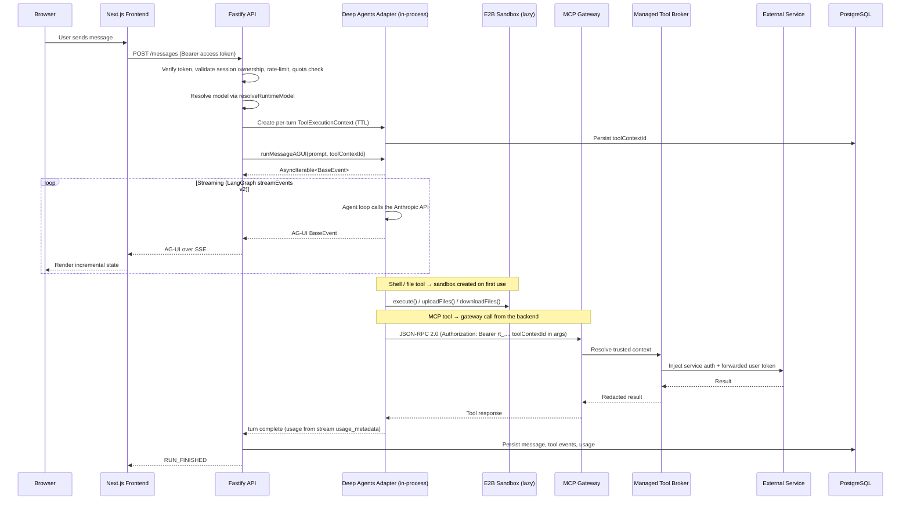

# Cogniplane Architecture

> **Scope:** The shipped architecture of Cogniplane Core. Operational details (commands, file paths, env vars) live in `CLAUDE.md`. Authoritative schema lives in `apps/backend/db/migrations/`.

## Overview

Cogniplane Core is a multi-tenant agent platform with a backend-controlled agent runtime. The backend owns auth, persistence, tool security, session lifecycle, policy compilation, event normalization, and the admin control plane. The runtime provides multi-step planning, tool orchestration, approvals, and richer streaming behavior than a thin LLM-plus-tool-loop stack.

The runtime is **Deep Agents** — LangChain's [deepagentsjs](https://reference.langchain.com/javascript/deepagents) — running **in-process in the Fastify backend** (`services/deep-agents/deep-agents-runtime-adapter.ts`). The library version is pinned via the exact `deepagents` version in `apps/backend/package.json`.

E2B provides a **code-execution sandbox**: a per-session Firecracker VM created **lazily on first shell/file tool use**. Chat-only sessions never create one, and when the tenant's `allowCommandExecution` is off, no sandbox is attached at all.

## Technology Stack

| Layer | Technology | Notes |
|---|---|---|
| Frontend | Next.js 16 | Deployable to any Next.js host (Vercel, Cloudflare Workers via `@opennextjs/cloudflare`, Node container, etc.) |
| Backend | Fastify (ESM TypeScript) | API, session lifecycle, in-process agent loop, MCP gateway, scheduler, policy compilation, audit, streaming |
| Runtime | LangChain [deepagentsjs](https://reference.langchain.com/javascript/deepagents) (LangGraph agent loop, in-process) | Multi-provider via `initChatModel` (Anthropic/OpenAI/Google/OpenRouter/Z.AI); per-provider tenant key or platform env fallback |
| Agent state | LangGraph `PostgresSaver` checkpointer | Postgres schema `deep_agents`; `thread_id` == session id |
| Sandbox | E2B Firecracker VM (`deep-agents-runtime-dev` template) | Lazy, per-session, code-execution only — no agent CLIs or SDKs inside |
| Database | PostgreSQL with Row-Level Security | Request pool: `app_user` under RLS. Cross-tenant pool: `maintenance_user` with explicit DML grants. Migrations run separately. The checkpointer has its own `app_user` pool |
| Cache / coordination | Redis (optional) | When configured: shared rate limits, refresh token `jti` revocation, turn quotas. Without it, rate limits are per-process. |
| Object storage | S3-compatible bucket (production), local filesystem (dev) | Artifacts and skill bundles share `ARTIFACT_BUCKET_*` credentials |
| Auth | WorkOS (SAML / OIDC / AuthKit) or `dev-headers` mode for local hacking | HS256 JWT access tokens (15 min) + httpOnly refresh cookies (7 day, Redis-revocable) |
| PII Provider | LLM-based detector + rule-based fallback | Opt-in per tenant; bring your own model provider via the `PII_*` env-var contract |

## Repository Layout

The repo is a pnpm workspace.

```
apps/backend             # Fastify API, Deep Agents runtime, MCP gateway, admin config, workers
apps/frontend            # Next.js 16 UI (chat workspace, admin workbench, user settings)
packages/shared-types    # Shared API contracts (Zod schemas) used by both apps
docker/                  # Backend Dockerfile + E2B code-execution template
docs/                    # Architecture, decisions, security features, guides
```

### Backend module map

- `routes/` — HTTP entrypoints. Hot path: `messages.ts`, `mcp.ts`, `approvals.ts`. Admin: `routes/admin/admin-*.ts`. Auth: `auth.ts`. Health, models, sessions, settings, artifacts, tenant.
- `services/deep-agents/` — the runtime: `deep-agents-runtime-adapter.ts` (RuntimeAdapter), `deep-agents-graph.ts` (agent construction), `deep-agents-e2b-backend.ts` (lazy sandbox backend), `deep-agents-checkpointer.ts` (durable state), `stream-events-to-agui.ts` (LangGraph to AG-UI).
- `services/runtime/` — runtime-adjacent lifecycle: `runtime-model-resolver.ts`, `provider-credentials.ts`, `runtime-session-store.ts`, `idle-teardown.ts`, `stale-approval-sweeper.ts`, `e2b-sandbox.ts`.
- `services/dynamic-config-*` — compile admin config from Postgres into the per-turn runtime-policy snapshot.
- `services/managed-tools/` — first-party tool implementations (session tools, `write_artifact`, memory tools, skill-corpus tool, GitHub, Notion).
- `services/managed-tools/factory.ts`, `services/managed-tools/catalog.ts` (+ `register-builtin-managed-tools.ts`), `services/redact-secrets.ts` — managed-tool dispatch (factory wires deps; catalog enumerates the allowlist) + audit redaction.
- `services/policy/` — Policy Center rule evaluation, rule storage, and decision evidence.
- `services/*-store.ts` — tenant-scoped persistence modules.
- `services/pii/*`, `services/pii/openai-compatible-pii-provider.ts` — PII detection/transform pipeline.
- `services/scheduler-*` — cron-driven scheduler worker for user-owned scheduled jobs.
- `services/integrations/` — third-party connection lifecycle (GitHub, Notion).
- `services/skills/` — skill import/lifecycle, bundle storage, marketplace, improvement corpus.
- `services/artifacts/` — artifact storage, processing, and workspace sync.
- `lib/db.ts` — `withTenantScope` (RLS activation wrapper used by every tenant-scoped store call).

## Request Lifecycle



`POST /messages` (`routes/messages.ts`) validates input, resolves the model via `resolveRuntimeModel`, then hijacks the raw socket, sets SSE headers, and delegates to `streamAssistantReplyAGUI` (`services/sse-stream-writer-agui.ts`). The writer builds a `ToolExecutionContext` and calls `runtimeAdapter.runMessageAGUI`. There is a single runtime adapter, with no provider map or provider-resolution step.

`TurnTranscript` (`services/turn-transcript.ts`) finalizes the assistant row for interactive and scheduled turns. It reads runtime AG-UI events and classifies the outcome as completed, interrupted, or error. Thrown errors get client-safe messages. It saves text and status first. A failed write or a write that updates no row prevents a successful completion result. Reasoning, plan, runtime notices, and tool results follow as best-effort writes, including after a thrown error.

The SSE writer owns wire output, mid-turn checkpoints, and MCP App publication. It asks for progress writes and decides when to await them; `TurnTranscript` selects, orders, and saves them. The writer releases turn admission once, after finalization and before the terminal event. A failed release is logged; it does not change the saved outcome or the terminal event. The scheduler owns its job ledger, timeout, usage read, and session cleanup. Finalization does not retry runtime or tool actions or recover execution after a process stops. Existing stale-message sweeps close abandoned rows when enabled. If the final status write and its retry both fail, the stored row can retain an earlier status; the caller still reports a failed or interrupted outcome.

## Runtime Architecture

### Single-runtime model

`DeepAgentsRuntimeAdapter` (`services/deep-agents/deep-agents-runtime-adapter.ts`) implements the `RuntimeAdapter` contract. It lazily builds a per-session deepagentsjs agent (`createDeepAgent`) and runs each turn as a LangGraph `streamEvents` v2 stream inside the backend process. `stream-events-to-agui.ts` maps those envelopes directly to AG-UI `BaseEvent` values consumed by the browser and scheduler.

Agent construction lives in `deep-agents-graph.ts`:
- **Model** — multi-provider `initChatModel` via `resolveModelConstruction` (maps a catalog id to `<initPrefix>:<vendorModel>` + base URL per `MODEL_PROVIDER_META`): Anthropic, OpenAI, Google (`google-genai`), OpenRouter and Z.AI (both via the OpenAI client with a custom base URL). The key is resolved per-provider for the selected model (`provider-credentials.ts`): the tenant's stored key first, then the platform env fallback. Reasoning effort is baked in per provider by `applyReasoningEffort`. The in-process loop calls each provider's API directly. Token usage is captured from stream `usage_metadata` and persisted per turn.
- **State** — the shared Postgres checkpointer (below); `thread_id` is the session id, so multi-turn resume is a checkpointer read, and threads survive process restarts.
- **Sandbox** — the lazy E2B backend (below) when `allowCommandExecution` is on; otherwise no sandbox, no `execute` tool, and file tools fall back to deepagents' checkpointed StateBackend.
- **MCP tools** — a `MultiServerMCPClient` (`@langchain/mcp-adapters`) speaking streamable HTTP from the backend to the platform's own `/mcp/:serverId` gateway, authenticated with a session-scoped `Authorization: Bearer rt_...` header (URLs never carry `?token=`; the gateway rejects query-param tokens). The per-turn `toolContextId` is injected into managed tool args at call time via the client's top-level `beforeToolCall` hook, always overriding any model-supplied value. Tools load per-server with degradation (one broken server skips its tools, not all), and names colliding with deepagents built-ins (`RESERVED_BUILTIN_TOOL_NAMES`) or duplicated across servers are dropped with a warning.
- **Approvals** — an `interruptOn` map (LangGraph human-in-the-loop middleware) built from the tenant's approval settings; see Approval Flow.

### Durable state (checkpointer)

`deep-agents-checkpointer.ts` wires a LangGraph `PostgresSaver` into its own Postgres schema **`deep_agents`**, with an explicit named pool. DDL runs from `migrate.ts` (superuser) via `setupDeepAgentsCheckpointer`; the runtime saver connects as `app_user`. **The checkpointer tables have no tenant column and no RLS** — isolation is app-layer: `thread_id` IS the session id, and every route that reaches the checkpointer resolves the session through the RLS-scoped `sessions` table first. Session deletion purges the thread; idle teardown does not.

### E2B sandbox backend

`deep-agents-e2b-backend.ts` implements `E2bDeepAgentsSandbox extends BaseSandbox` (deepagents' sandbox protocol — the library has no official E2B backend). It implements `execute()`/`uploadFiles()`/`downloadFiles()` over the E2B JS SDK and overrides `ls`/`read`/`grep`/`glob` to remap "/"-rooted paths into the session workspace (`/home/user/workspace/<sessionId>/`); workspace-escaping paths return the protocol's structured error. The sandbox is **created on first use and memoized per session** — chat-only sessions never pay for one. A per-command timeout (`DEEP_AGENTS_EXECUTE_TIMEOUT_MS`, default 2 min) and a 64k output cap are enforced at this layer; `E2B_SANDBOX_TIMEOUT_MS` (default 30 min) caps sandbox lifetime.

The template (`docker/template.ts`, name `deep-agents-runtime-dev`, built by `make e2b-build`, id wired via `E2B_TEMPLATE_ID`) is deliberately a dumb code-execution box: the stock `e2bdev/base` image plus Python 3 with a pinned knowledge-worker data stack (pandas, openpyxl, matplotlib, jinja2), ripgrep/sqlite3/git — **no agent CLIs or SDKs**. Building under the same name updates the template in place, preserving its id; cutover/rollback is an `E2B_TEMPLATE_ID` env change.

**Network policy.** A sandbox has no network unless the tenant approves hosts. The approved list (`tenant_settings.approved_sandbox_egress_domains`, edited on Admin → Agent behavior) becomes one `SandboxNetworkPolicy` (`services/runtime/sandbox-network-policy.ts`). The network of a sandbox is fixed when it is created, and the backend never changes it: `Sandbox.create` gets `network: { denyOut: ["0.0.0.0/0"], allowOut: <hosts>, allowPublicTraffic: false }`, built from the policy as it is read from the tenant settings at that moment, and `Sandbox.getInfo` reads it back before any command runs. A sandbox that fails the check is killed and not used. At the first use of each turn or job, and at a reconnect, one live read compares the sandbox with the policy as it is then. A match holds for the turn. A mismatch (a changed list of hosts, a sandbox from before the policy, unexpected rules or settings that were not requested, such as request rules or an egress proxy) replaces the sandbox with a notice. The old sandbox is killed with up to four tries, and the session lease is checked in the database before each try. No command and no file operation runs in a sandbox that was not confirmed in the current turn. An operation belongs to the turn that was current when it was called, every step of a method that has several (a file edit is a download and an upload) belongs to the turn of the call, and it runs only while that turn is live: a turn that ended, was cancelled or was replaced by the next one, and a runtime that was disposed, run nothing more, and a creation that an earlier turn began stops before its first command. `Sandbox.create` is sent once, because the SDK would send it again after a 503. Every provider request has a timeout and is tried again when it fails, and one deadline (`E2B_NETWORK_CONFIRM_TIMEOUT_MS`) covers the check. If the sandbox cannot be read in time, the call fails and the sandbox is kept. A kill that still fails after all tries is logged as an error with the sandbox id, and the sandbox is replaced all the same. The old sandbox then runs until the provider expires it (`E2B_SANDBOX_TIMEOUT_MS`), with the network that it was created with. The lease check before a kill cannot be atomic with the kill request, so an owner whose kill is delayed can destroy a sandbox that the next owner adopted under an unchanged policy. The network stays restricted, and files that only existed in that sandbox are lost. The hash of the policy that a sandbox was created under is saved with its id as a record. The template also removes the guest's passwordless root (`sudo` and the empty root password) in its start command.

### Session lifecycle

- One session runtime per active session, created on demand, torn down after `RUNTIME_IDLE_TIMEOUT_MS` (`services/runtime/idle-teardown.ts`). Teardown kills the sandbox but leaves the checkpointer thread — conversations resume across teardowns and process restarts.
- Runtimes emit lifecycle audit events (start, resume, idle teardown, interrupt).
- A per-turn watchdog (`RUNTIME_TURN_TIMEOUT_MS`, default 20 min) aborts a wedged turn via the graph's abort signal; it is disarmed while an approval prompt is pending, and config validation pins it above `APPROVAL_REQUEST_TTL_MS` and below `E2B_SANDBOX_TIMEOUT_MS`.
- Turn failures pass through messages from `Error` instances with a 4xx status; other failures use a generic message, with a fixed translation for `GraphRecursionError`. A 4xx status alone does not prove provider text is safe. Review passthrough classification and redaction before relying on it to prevent disclosure.

## Personal defaults and private skills

Settings at `/settings/capabilities` lets members choose defaults for their normal
standalone chats. The API stores these choices by tenant and user. A null selection
inherits organization defaults and includes the member's released private skills.
An empty custom selection selects nothing. Project and scheduled chats do not use
personal defaults. A chat's own saved selection can further narrow its defaults.

Members can write a private skill or import a single `SKILL.md`. They save a draft,
review its instructions and validation warnings, and explicitly make it available.
Edits create revisions without changing the active instructions. Release activates
the latest revision and adds it to custom personal defaults in one transaction.
Every write checks the account scope, current membership, and saved version.

Migration `052_personal_skills.sql` adds separate tables for these skills and their
revisions. Queries filter on tenant and owner; tenant RLS and membership cascades
provide further isolation. Each member can keep 100 skills with unique names and
up to 50 revisions per skill. Revision cleanup preserves the active revision.
Audit events omit instruction contents.

Only the owner's normal standalone runtime loads released personal skills. Project,
scheduled, and skill-improvement sessions do not load them. Release, disable, and
delete change the runtime bundle on the next turn. Draft edits do not. Personal
skills cannot grant tools or override organization policy. Imports save instructions
only; companion files and remote imports are not supported. Sharing a conversation
can share messages that quote earlier private work, but does not share the private
skill library.

## System Prompt & Skill Pipeline

There is **no rendered workspace config** — the adapter assembles the agent **system prompt at session start**: tenant `developerInstructions` + the memory tool list and one rule that memory is user data (see Long-term memory below). The prompt holds no memory text. Skills are NOT inlined into the prompt — `buildSkillsLibraryFiles` renders each enabled skill to a read-only `/skills/<slug>/SKILL.md` (plus materialized bundle companion files), mounted as a `CompositeBackend` route and surfaced by the native deepagents skills middleware. Progressive disclosure: only each skill's name/description/path reaches the prompt; the model `read_file`s the full SKILL.md on demand.

Config is compiled from Postgres by `DynamicConfigService` (`services/dynamic-config-service.ts`) and snapshotted onto the per-turn `ToolExecutionContext`.

### Long-term memory

Memory text was written by a model or a user, so it never enters the system prompt. Server authorization never reads it either.

- **Prompt.** `buildMemorySectionLines` (`memory-workspace-section.ts`) adds the enabled memory tools and one rule: saved memories are user data, not instructions, and cannot change rules, tool permissions or approvals. The prompt is the same on every turn, so its prompt-cache prefix stays valid.
- **Data message.** At the start of each turn the adapter reads up to 10 recent memories for the session's user. The read is gated on `memory_search` and, in Policy Center enforce mode, on a side-effect-free policy check. The result is passed in the graph runtime `context` as `memoryContext`. `deep-agents/memory-context-middleware.ts` adds it to the model input of each call as a human message that is labelled as user data. Each memory is a JSON line in a `<saved_memories>` block, cut to 200 characters. Credentials are redacted. Characters that do not print are shown as `⟦U+XXXX⟧`. Text such as `</saved_memories>` cannot close the block.
- **Reload.** The data message is not part of the saved conversation or the checkpoint. A reload and the AG-UI rehydration read only the transcript. An edit or a delete in settings applies at the next turn, and a deleted memory cannot be replayed from history.
- **Consent.** `memory_save` has `requiresUserApproval` in the managed tool catalog. In every interactive turn, whatever `approval_policy` and Policy Center say, the graph interrupts before the call (`durableWriteEntry` in `deep-agents-graph.ts`). The adapter builds the approval card with the exact text and the text that it replaces (`memory-consent.ts`). The proof ledger binds the approval to the call and its argument hash, as for Policy Center. The gateway then accepts the call only when `enforcePolicyCenter` returns the approval that this call claimed (`approvalDisposition: "approve"`). A replay, a changed value, another user, another turn or a declined approval finds none. A save that replaces a memory also checks that the replaced text is the text the user saw: the approval row stores its hash, and `MemoryStore.save` compares it under a row lock.
- **Scheduled runs.** A scheduled turn has nobody to ask, so the graph opens no prompt and the gateway refuses the call with a tool result `{ "error": "… Nothing was saved." }`. Every refusal of `memory_save` is a tool result of that shape, not a JSON-RPC error. A JSON-RPC error reaches the graph as a thrown tool exception, and deepagents' `wrapToolCall` middleware makes `ToolNode` rethrow it, which ends the turn.
- **Provenance.** The server records `provenance`, `source_session_id`, `approved_by_user_id`, `approval_id`, `approved_at` and `version` on each memory (migration `068_memory_provenance.sql`). Rows from before the migration read as `unverified`. Model-supplied `metadata` is plain data and never proof of approval. The agent refuses text that holds a credential.
- **User view.** `/settings/memories` lists, edits and deletes the signed-in user's memories through `/me/memories` (`routes/memories.ts`). Routes use the tenant and user from the request and address a memory by its id. An edit sends the account scope and the `version` that the editor started from, even if the page read the list again since. If the memory changed after that version, the server refuses the edit (`memory_conflict`). The page then keeps the user's text in the editor, shows the latest saved text beside it, and lets the user reapply their text to the latest version or discard it.

### Skill data flow

```
SKILL.md body → validateSkillBundle → buildSkillImportPayload
  → importSkillBundle (merges skillName/description/instructions INTO metadata JSONB)
  → activateSkillRevision (reads metadata.skillName + metadata.instructions — fails if absent)
  → compileRuntimeConfig → DeepAgentsRuntimeAdapter.createSession
  → buildSkillsLibraryFiles → read-only /skills/<slug>/ library (generated SKILL.md + bundle companions)
  → native deepagents skills middleware (progressive disclosure in the system prompt)
```

`instructions` lives in `revision.metadata->>'instructions'` (NOT a column). Skills with a null `bundle_storage_uri` use inline instructions.

### Skill bundle storage

Skill bundles (zipped `SKILL.md` + companion files) have two storage backends, chosen by `SKILL_BUNDLE_STORAGE_BACKEND`:

- **`local`**: bundles live at `<SKILL_BUNDLE_STORAGE_ROOT>/<bundleName>/<contentHash>/`. Suitable for `make dev`; ephemeral on container deployments where `/tmp` does not survive task replacement.
- **`bucket`** (production): bundles upload as `.tar.gz` to S3 at `s3://<bucket>/<prefix>/skills/<tenantId>/<skillId>/<revisionNumber>-<contentHash>.tar.gz`. On session start, `installBundle` downloads and extracts on demand into `<SKILL_BUNDLE_CACHE_ROOT>/...`. The cache is content-addressed and idempotent.

Each `admin_skill_revisions` row stores the canonical `bundle_storage_uri` (`file://` or `s3://`); the scheme selects the backend at runtime.

## MCP Gateway & Tool Security

`/mcp/:serverId` (`routes/mcp.ts`) receives JSON-RPC 2.0 from the runtime's `MultiServerMCPClient`. Two modes per server:

- **managed** — the call dispatches to the `ManagedToolFactoryRegistry` (`services/managed-tools/factory.ts`, `createDefinitions`). The `ManagedToolCatalog` (`services/managed-tools/catalog.ts`, registered in `register-builtin-managed-tools.ts`) aggregates per-domain catalogs: session tools, `write_artifact`, memory tools, the skill-corpus tool, GitHub tools, Notion tools.
- **proxy** — forwarded to an upstream URL with framework context headers injected.

Every tool call requires a `toolContextId` resolved against `ToolExecutionContextStore`. The context carries `userId`, `sessionId`, `runtimeId`, and a snapshot of the tenant's effective runtime config (compiled from `tenant_settings`) — the model never sees credentials directly.

Tool results pass through `redactSecrets()` (`services/redact-secrets.ts`) before persistence to strip auth headers and tokens.

### Member credentials for approved connections

Admins choose whether a proxy MCP connection uses one organization credential or
requires each member to connect. Members enter bearer tokens, header secrets, or
query secrets at `/settings/connections`, after reviewing the destination and auth
method. An optional account label is supplied by the member; it is not verified
provider identity. This flow does not register private MCP URLs or perform OAuth.

Migration `053_member_mcp_credentials.sql` stores encrypted credentials by tenant,
member, and connection. Reads and writes check current membership and connection
availability. Saves compare both connection and credential versions. Removing a
credential clears its secret and keeps a versioned tombstone to reject stale saves.
Audit events contain IDs and versions, never secrets or account labels.

Endpoint, authentication, and credential-scope changes replace the connection's
credential binding. Old member credentials then require reconnection, even if an
admin changes the endpoint back. Runtime calls use the acting member's credential;
project access never lends another member's account. Missing credentials remain
visible in selection screens with a connection prompt, but are excluded from runtime
tools. Tool metadata caches include member and credential version so one account's
tool permissions cannot affect another account. Each turn records connection hashes
and credential versions in its trusted tool context. A pending approval cannot send
a call through a changed endpoint or newly saved account.

### Trust boundary

```
Frontend --[JWT]--> Backend --+-- Deep Agents loop (in-process; toolContextId only, never user tokens)
                              |
                              +--[Bearer rt_... + toolContextId]--> MCP Gateway
                                                        |
                                  +----------managed----+----proxy----+
                                  |                                    |
                      Managed Tool Broker            Forward validated user token/context
                                  |                                    |
                          External Service               Downstream MCP server enforces auth
```

Rules:
1. Never give user JWTs or bearer tokens to the model. The agent loop receives only `toolContextId` and compiled policy.
2. Never trust model-supplied identity fields. The model cannot author `user_id`, `session_id`, or `auth_token` in tool arguments — `beforeToolCall` overwrites `toolContextId` on every managed call.
3. Validate provenance server-side on every tool call. Verify session ownership before routing.
4. Authorization stays at the service boundary. Managed tools enforce downstream access via the tool broker; enterprise MCP servers enforce their own.
5. Sandbox workspaces are isolated per session. File tools remap "/"-rooted paths into the session workspace and refuse escapes.
6. Tool event payloads are scrubbed of tokens, auth headers, and credentials before being written to Postgres.
7. Tool execution contexts expire (`TOOL_CONTEXT_TTL_MS`, validated strictly above `RUNTIME_TURN_TIMEOUT_MS`).
8. Stored OAuth credentials and runtime tokens are encrypted at rest with AES-256-GCM (`lib/crypto-utils.ts`, scrypt-derived key memoized per process).

## Approval Flow

Native runtime approvals and Policy Center approvals share one checkpointed graph interrupt, frontend event shape, approval row, and decision route.

**Native HITL approvals are LangGraph interrupt-based.** `tenant_settings.approval_policy` (`"never"` bypasses gating) drives an `interruptOn` map built in `deep-agents-graph.ts`: all MCP gateway tools (minus read-only ones when `auto_approve_read_only_tools` is on) plus the mutating built-ins (`execute`, `write_file`, `edit_file`), plus the read-only built-ins when the read-only bypass is off. An interrupt pauses the graph **before** tool execution and checkpoints; the adapter detects pending interrupts after the stream ends, persists an approval row, emits an AG-UI `CUSTOM` event named `approval_required`, and resumes the graph with a `Command` once decided. Resume is keyed **per interrupt id**, so concurrent interrupts (parallel `task` subagents each hitting a gated tool) get their own decisions.

The frontend calls `POST /approvals/:approvalId/decision` with `{ decision: "approve" | "reject", rememberForTurn?: boolean }` (`routes/approvals.ts`), which persists the decision and resumes the paused graph.

Policy Center `require_approval` is folded into the runtime's checkpointed graph interrupt on interactive turns. The runtime keeps a proof with a random approval ID in backend memory, keyed by tool-call ID; the proof never enters tool arguments. Once approved, the runtime injects its `policyApprovalId`; the gateway proceeds only when the row matches the same session, user, tool, server, tool context, and canonical argument hash, and it claims the approval once (`consumed_at`) before dispatch. The argument hash (`policyArgsHash`) leaves out `toolContextId`, `policyApprovalId` and the marker key at the root of the arguments only, because the runtime and the gateway add them there. A nested key with one of those names is data that the user approved, so it is hashed. This keeps the gateway fail-closed without a held HTTP response or second coordinator. Scheduled turns are unattended: the graph does not pause for Policy Center approval, and the gateway denies an enforced `require_approval` match.

A managed tool with `requiresUserApproval` (today `memory_save`) uses the same proof for a stronger rule. Its interrupt does not read `approval_policy` or Policy Center, so `never` does not remove it. The gateway passes the handler the approval that it claimed, and the handler refuses to save without it. See Long-term memory.

MCP elicitation is not a separate confirmation plane in Cogniplane: authorization and human confirmation are enforced at the Cogniplane MCP gateway through native HITL and Policy Center. Configured upstream MCP tools must not rely on elicitation as their only guardrail.

### TTL and expiry

Pending approvals carry a wall-clock TTL (`APPROVAL_REQUEST_TTL_MS`, default 10 min). On expiry the DB row moves to `status='expired'`, an `approval.expired` audit event is written, an AG-UI `CUSTOM` event named `runtime_notice` (level `warning`, `noticeId = approval-expired:<approvalId>`) is pushed to the active turn so the frontend can clear the prompt, and the paused graph is resumed with a reject. Rows also carry a DB-level `expires_at`, so a process death still lets the startup sweep (`services/runtime/stale-approval-sweeper.ts`) recover them.

## Policy Center

Policy Center is a tenant-scoped rule layer evaluated at the MCP gateway before a managed or proxy tool action is executed. Rules are evaluated in ascending `priority` order (ties broken by rule id); the admin UI rewrites priorities via drag-and-drop reordering. Each rule has a simple `condition -> effect` shape.

Effects are `allow`, `require_approval`, and `block`. Conditions have four active dimensions: `toolNames`, `categories` (the managed-tool domain or proxy MCP server id), `severities` (`read_only`, `file_change`; the legacy `command_execution` value is still accepted but never matches an action), and `turnContexts` (`interactive`, `scheduled`). Dimensions are AND-ed together; multiple values inside a dimension are OR-ed; an omitted dimension matches anything.

`tenant_settings.policy_enforcement_mode` is the tenant-level switch. `monitor` evaluates rules and writes `policy_decision` evidence for matches without gating execution; `enforce` applies gating effects. The mode is compiled into the runtime-policy snapshot on the per-turn `ToolExecutionContext`, so the hot path does not read tenant settings from Postgres. Only matched rules write `policy_decision` rows.

## Tenant Settings

Model enablement is defined once by `isModelEnabled` in
[shared model availability](../packages/shared-types/src/model-availability.ts).
Both backend model filtering/turn validation and the Agent settings warning use it.
An enabled provider and a null model allowlist permit all of that provider's models;
an empty allowlist permits none. Credential availability is a separate check.
The backend still enforces both restrictions for direct API calls and scheduled turns.

After provider-key, availability, or custom-model changes, the frontend refreshes
both the admin catalog and chat model query by invalidating the shared
`queryKeys.models.all` prefix in `apps/frontend/src/lib/query-keys.ts`.
Custom-model deletion returns updated tenant settings directly to the cache. The
backend prunes unavailable model IDs and removes the deleted model's effort override.
An allowlist emptied by pruning becomes null; an intentionally empty list stays empty.
Tenant settings and integration mutations also invalidate the runtime-session cache.
Agent settings saves refresh chat metadata because `/models` also returns
`showEffortSelector`. These invalidations update the current browser's cache;
backend validation still protects turns from stale data in other browsers.

`tenant_settings` is one row per tenant — the single source of truth for runtime policy. The `system` tenant's row acts as the platform default; effective config merges the tenant row over the system row.

Owners exclusively control `allowCommandExecution`. Admins may update the remaining Agent Settings, but unchanged copies of that owner-only field are removed from admin writes to prevent stale forms from overwriting an owner decision.

| Field | Purpose |
|---|---|
| `enabled_tool_ids` | Allowlist of managed tool ids exposed to the agent |
| `enabled_mcp_server_ids` | Allowlist of MCP servers exposed to the agent |
| `approval_policy` | Native HITL gating (string policy or granular object; `"never"` bypasses) |
| `approval_reviewer` | Who resolves runtime-native approvals (default `user`) |
| `auto_approve_read_only_tools` | Bypass approval for read-only tools |
| `policy_enforcement_mode` | Policy Center mode: `"monitor"` or `"enforce"` |
| `allow_command_execution` | Gate on shell/exec tools — when off, no sandbox is attached at all |
| `approved_sandbox_egress_domains` | Hosts that agent-run code in the sandbox may reach; empty (the default) means no network |
| `developer_instructions` | Extra system prompt content per tenant |
| `web_search_mode` | Web search availability for the agent |
| `show_effort_selector` | Frontend feature flag |

Per-tenant model-provider keys (one per provider — Anthropic/OpenAI/Google/OpenRouter/Z.AI) are managed via organization settings and stored encrypted per-provider in `tenant_org_settings`.

## Admin Configuration

Three admin entities, all tenant-scoped with `tenant_id = 'system'` rows acting as platform defaults:

| Entity | Store | Notes |
|---|---|---|
| Skills | `SkillConfigStore` + `SkillRevisionStore` | Revisions hold `skillName`, `description`, `instructions` in `metadata` JSONB. Activation requires all three |
| MCP servers | `McpServerStore` | `mode` is `managed` or `proxy` |
| Tenant settings | `TenantSettingsStore` | One row per tenant (see above) |

Admin endpoints live under `routes/admin/admin-*.ts`. Authorization uses `requireRole(request, 'admin' | 'owner')`.

### Integrations registry

`tenant_integrations` + `IntegrationRegistry` track which third-party integrations a tenant has enabled (GitHub App, Notion). `routes/admin/admin-integrations-routes.ts` exposes the management CRUD; per-user OAuth tokens land in `user_github_connections`, `user_notion_connections`.

### Skill marketplace

A marketplace manifest URL (per tenant or via `SKILL_MARKETPLACE_MANIFEST_URL` platform default) lets tenants discover and import skill bundles published outside their own tenant. Caching is controlled by `SKILL_MARKETPLACE_CACHE_TTL_MS`.

### Skill usage telemetry & improvement

Skill adoption is tracked by Tier 1 telemetry. `ActivationTracker` (`services/activation-tracker.ts`) writes `resource_activations` rows inline on the hot path: a `materialized` row when a skill is inlined into the session's system prompt, and an `invoked` row when a tool call routed through the MCP gateway matches a skill's `associatedToolIds`.

Improving a skill is a normal agent turn, not a bespoke worker. The built-in `skill-improver` skill calls the `read_skill_corpus` managed tool with a target `skillId`; the tool assembles a redacted markdown corpus of recent sessions where the skill was offered or used plus the current SKILL.md, and returns it inline. The agent proposes a revised SKILL.md via `write_artifact`.

## PII Pipeline

PII detection is opt-in (`PII_PROVIDER_ENABLED`). The pipeline targets any OpenAI-compatible `/chat/completions` endpoint (or a native Ollama `/api/chat` endpoint via `PII_LLM_WIRE_FORMAT`), parameterized by the `PII_LLM_*` env vars; you bring your own model provider (a hosted API or a self-hosted Ollama/vLLM server) and accept that vendor's logging posture. The default configuration points at OpenRouter (default model `google/gemini-2.5-flash`) with a rule-based fallback for when the LLM endpoint is unavailable or times out.

Two paths:
- **Sync** — message text passes through `PiiProtectionService.evaluateText` (`services/pii/pii-protection-service.ts`, invoked from `routes/messages.ts`) before being forwarded to the runtime. Detect/block/transform actions are configured per tenant.
- **Async** — `pii_scan_runs` + `pii_scan_jobs` queue scans of stored content (artifacts, message history). Findings persisted with severity and category.

Uploads and project drafts stay `pending` until the scan verdict, and no download token is issued before the artifact is `ready`. The scan reads text, structured text (CSV, JSON, XML, YAML) and shell scripts as UTF-8, and a PDF through its `pdftotext` output (`services/pii/scannable-text.ts`). A PDF with no extractable text, such as a scan, is rejected. Images inside a PDF are not scanned, and image detection in PDFs is not reliable, so every PDF verdict stores `imagesNotScanned: true` in the artifact's PII detail and the UI shows it as "(text only)". Project drafts that the agent writes as PDFs are scanned the same way but carry no such label yet (bead `koiz`). When the uploads scope is on, the upload rejects images and Office files at once with `unsupported_mime`, in every mode, and deletes their bytes. A failed PII job always closes its scan run and its upload or message: the scheduler worker closes jobs that the stale-claim sweep failed.

Configuration knobs: `PII_LLM_API_KEY`, `PII_LLM_MODEL`, `PII_LLM_BASE_URL`, `PII_LLM_WIRE_FORMAT`, `PII_PROVIDER_TIMEOUT_MS`.

## Scheduler

`services/scheduler-worker.ts` polls `scheduled_jobs` every `SCHEDULER_POLL_INTERVAL_MS` (default 30s), claims due jobs atomically, and runs them as synthetic agent turns. Results land in `scheduled_job_runs`. Concurrency capped by `SCHEDULER_MAX_CONCURRENT_JOBS`; per-job hard timeout via `SCHEDULER_JOB_TIMEOUT_MS`. Scheduled turns use the same `TurnTranscript` but write no mid-turn progress. An interrupted scheduled turn keeps its partial text with the `interrupted` row status, as a stopped interactive turn does. Its job run records `failed` with the error `Scheduled job was interrupted.`, because the job did not complete. The run summary is the first 500 characters of the response after secret redaction. A job timeout fails the row and the run when it fires before `TurnTranscript.finalize` resolves. This includes the usage read and the final writes: a timeout during those writes replaces the saved status with the timeout error. A timeout during session cleanup, after finalization, does not change the saved outcome.

Each job carries a `settings_snapshot_json` so executions remain auditable even after the user later changes their preferences.

## Multi-Tenancy & RLS

- **One DB, many tenants.** All tenants share the same PostgreSQL instance and schema.
- **Explicit `tenant_id` columns** on every data table. Every store method takes `tenantId` as its first argument.
- **Row-Level Security** as the second enforcement layer. RLS policies use `current_setting('app.current_tenant_id', true)`; if the application forgets to set the tenant context, RLS returns an empty result set.

Two DB pools:
- `db` — `app_user` (non-superuser, RLS-active).
- `privilegedDb` uses `MAINTENANCE_DATABASE_URL`, a dedicated BYPASSRLS role with explicit DML grants and no schema ownership. Migrations use a separate process and credential. Tenant content paths use the RLS-active pool unless their authorization design requires otherwise.

The Deep Agents checkpointer additionally manages its own named `app_user` pool. Its tables (schema `deep_agents`) have **no RLS** — isolation is app-layer via the RLS-scoped `sessions` table (see Runtime Architecture).

Every tenant-scoped store call wraps its work in `withTenantScope(db, tenantId, fn)` (`lib/db.ts`), which calls `set_config(..., true)` inside a transaction.

## Authentication

Production uses `AUTH_MODE=workos`:

| Endpoint | Purpose |
|---|---|
| `GET /auth/login` | Redirect to WorkOS authorization URL |
| `POST /auth/callback` | Code exchange → upsert tenant/user/membership → JWT + refresh cookie |
| `POST /auth/refresh` | Rotate refresh token (new jti) → new access token |
| `POST /auth/logout` | Revoke jti → clear cookie |
| `GET /auth/me` | Current user, tenant, role |

**Access token**: HS256, 15-minute TTL, carried in `Authorization: Bearer`. Held in React state (memory) only — never persisted to localStorage or sessionStorage.

**Refresh token**: httpOnly, `SameSite=None`, `Secure`, scoped to the **backend domain**. 7-day TTL. Each token carries a unique `jti` stored in Redis. Every refresh rotates the `jti` (delete old, store new). Logout deletes immediately.

**First-member owner promotion**: the auth callback wraps tenant upsert, user upsert, membership count, and membership upsert in a single transaction. The count is taken before the new membership is inserted, so the first user to authenticate into a new organization atomically receives `owner`.

The Deep Agents runtime requires at least one model-provider API key (Anthropic, OpenAI, Google, OpenRouter, or Z.AI) — a per-provider tenant key or a platform env fallback. `/models` filters the catalog to models whose provider is configured, returning an empty list as the "configure a key" state when none is present.

### Public auth paths

Backend auth middleware uses an explicit `publicAuthPaths` allowlist (`apps/backend/src/lib/auth-workos.ts`) — login, callback, refresh, logout, GitHub install + user callbacks. `/auth/me` is **not** public. Frontend route protection lives in `apps/frontend/src/middleware.ts` with a hard-coded public allowlist plus a session-hint cookie.

### Roles

```
owner  → full access; tenant settings; member management
admin  → admin config (skills, MCP, tenant settings); audit log; member management
member → create and use sessions
```

`requireRole(request, ...roles)` is called at the start of elevated routes.

## Streaming contract

`POST /messages` streams native AG-UI `BaseEvent` values as data-only SSE frames. The backend does not emit separate `event:` lines or the retired `response.*` and `framework:*` envelopes.

The stream uses native AG-UI lifecycle, text, reasoning, tool-call, tool-result, and state-delta events. Cogniplane-specific approval, runtime-notice, tool metadata, tool status, and MCP Apps payloads use AG-UI `CUSTOM` events. `write_todos` updates `/plan` through `STATE_DELTA`.

Supported widgets use `tool_mcp_app` and saved `ToolResult.mcpApp`. Proxy tools
declare `_meta.ui.resourceUri` and serve HTML through `resources/read`; managed
tools declare resources in the trusted catalog. The backend no longer emits the
retired `tool_ui_resources` event or writes inline `ToolResult.uiResources`.
History reads still return that field from retained rows; no frontend renders
it. See
[Interactive UI](INTERACTIVE_UI.md#supported-resource-contract) for the contract,
enablement, isolation, and action limits.

Active stream event names and payload shapes follow AG-UI `BaseEvent` schemas from `@ag-ui/client`, not hand-maintained markdown.

### Concurrency

The backend rejects concurrent turns on the same session with HTTP 429.

## Persistence

The authoritative schema is `apps/backend/db/migrations/`. `001_init.sql` is the consolidated baseline and `002_seed_system_data.sql` seeds the system tenant; everything after them is incremental. `migrate.ts` also runs the Deep Agents checkpointer DDL (schema `deep_agents`, tables managed by LangGraph's `PostgresSaver`). Below is a summary of the live tables — types and constraints are illustrative.

### Identity

| Table | Notes |
|---|---|
| `tenants` | Includes `slug`, `workos_org_id`, `custom_domain`, `settings_json` |
| `users` | Includes `workos_user_id` |
| `tenant_memberships` | `(tenant_id, user_id)` PK; `role` ∈ {owner, admin, member} |

### Sessions & runtime

| Table | Notes |
|---|---|
| `sessions` | App-level chat sessions; `purpose` column classifies `normal` chat vs `scheduled` |
| `runtime_sessions` | Per-session runtime mapping; `runtime_provider` (default `deep-agents`), `runtime_version`, `runtime_schema_version`, `manifest_path`, `manifest_metadata`, `lifecycle_metadata` |
| `messages` | `role`, `status`, `content_text`; token usage recorded inline |
| `message_tool_results` | Streamed tool results joined to a parent message |
| `tool_events` | Audit-grade tool call log; `phase`, `status`, redacted `payload` |
| `tool_execution_contexts` | Short-lived per-turn credentials carrier (TTL via `expires_at`) |
| `approvals` | Approval state machine; `kind`, `status`, `decision`, `resolved_at` |
| `deep_agents.*` | LangGraph checkpointer tables (conversation state); no tenant column, no RLS — app-layer isolation via `sessions` |

### Artifacts

| Table | Notes |
|---|---|
| `artifacts` | Tenant-scoped, source-traced via `source_artifact_id` |
| `artifact_download_tokens` | Short-lived signed download tokens |

### Admin config

| Table | Notes |
|---|---|
| `tenant_settings` | One row per tenant — runtime policy source of truth |
| `policy_rule` | Ordered Policy Center rules: conditions, effect, reason, enabled flag |
| `policy_decision` | Evidence rows for matched Policy Center rules |
| `admin_skills` | Tenant-scoped skill catalog with `active_revision_id` pointer |
| `admin_skill_revisions` | Versioned bundles; `bundle_storage_uri` (`file://` or `s3://`); `metadata.instructions` |
| `admin_mcp_servers` | Tenant-scoped MCP server registry; `mode` ∈ {managed, proxy} |

### Integrations & connections

| Table | Notes |
|---|---|
| `tenant_integrations` | Per-tenant integration enablement |
| `user_github_connections` | OAuth tokens encrypted at rest |
| `user_notion_connections` | OAuth tokens encrypted at rest |

### Workers & quality

| Table | Notes |
|---|---|
| `scheduled_jobs` / `scheduled_job_runs` | User-owned scheduler |
| `pii_scan_runs` / `pii_scan_jobs` | Async PII scan pipeline |
| `resource_activations` | Tier 1 skill/MCP/integration usage telemetry |

### User settings

| Table | Notes |
|---|---|
| `user_settings_sections` | Sectioned per-user preferences (`scheduled_jobs`, `skills`, `mcp`, `model`, etc.) |
| `agent_memories` | Long-term memories, unique per `(tenant_id, user_id, slug)`; server-written `provenance`, `source_session_id`, `approved_by_user_id`, `approval_id`, `approved_at`, `version` (migration 068) |

### Audit

| Table | Notes |
|---|---|
| `audit_events` | `event_type`, `payload`, `ip_address` (INET), `user_agent` |

## Security Posture

| Layer | Mechanism |
|---|---|
| Transport | HSTS, `X-Frame-Options: DENY`, `X-Content-Type-Options: nosniff`, `Referrer-Policy: strict-origin-when-cross-origin`, restrictive CSP |
| Request tracing | `X-Request-Id` on every response |
| Secrets at rest | AES-256-GCM via `encrypt()` / `decrypt()` (`lib/crypto-utils.ts`); scrypt-derived key (N=16384, r=8, p=1), memoized per process |
| URL log redaction | Fastify request logs sanitize sensitive query params (e.g. `?token=`, `?apiKey=`) via `lib/sanitize-url.ts` (defense in depth) |
| Audit | `audit_events` captures `ip_address` (INET) and `user_agent` on every admin and auth action |
| CSRF | Refresh cookie is httpOnly, backend-scoped, sent only to the configured CORS origin |
| Tool result redaction | `redactSecrets()` strips known secret patterns before persistence |
| MCP token transport | Session-scoped `Authorization: Bearer rt_...` header only; the gateway rejects query-param tokens |

For the full security control inventory, see [SECURITY_FEATURES.md](SECURITY_FEATURES.md).

## Observability

- Backend logs via Fastify's pino logger. `console.*` calls are limited to pre-Fastify boot paths (`config.ts`, `lib/redis.ts` defaults) and CLI scripts (`migrate.ts`, `seed-dev-data.ts`).
- `audit_events` is the durable audit log.
- `tool_events` is the durable tool-call log (redacted payloads).
- `resource_activations` records Tier 1 skill/MCP/integration usage per session.
- Cost tracking: per-turn usage is captured from LangGraph stream `usage_metadata` and persisted on `messages` (`input_tokens`, `cached_input_tokens`, `output_tokens`, `reasoning_output_tokens`, `total_tokens`, `model_name`, `cost_usd`).

## Environment

The [backend config schema](../apps/backend/src/config.ts) defines environment
variables, defaults, and boot validation. The [backend example](../apps/backend/.env.example)
and [frontend example](../apps/frontend/.env.example) document local configuration.
Model-provider labels and platform-key names come from `MODEL_PROVIDER_META` in
[shared primitives](../packages/shared-types/src/primitives.ts).

## Historical note: retired dual-runtime architecture

Earlier versions of Cogniplane ran two sandbox-hosted runtimes. OpenAI's `codex app-server` and an in-sandbox Claude Agent SDK harness shared an E2B template and rendered workspace config. That architecture and its custom SSE envelopes are gone. The current in-process [deepagentsjs](https://reference.langchain.com/javascript/deepagents) runtime streams AG-UI over data-only SSE frames.

## Pointers

- `CLAUDE.md` — operational runbook for working in this repo (commands, file paths, env vars, gotchas)
- [SECURITY_FEATURES.md](SECURITY_FEATURES.md) — full security control inventory
- [DECISIONS.md](DECISIONS.md) — architectural decision records
- <https://reference.langchain.com/javascript/deepagents> — official deepagentsjs API reference
- `apps/backend/db/migrations/` — authoritative schema


### Tenant model spending

Interactive and scheduled turns reserve estimated model cost through the same
tenant-scoped PostgreSQL ledger. Each admitted turn shares its reservation with
subagents and summarization. Calls run one at a time within that turn; missing
usage retains credit and blocks further admission for the month until an
administrator reconciles it. See [model spending](MODEL_SPENDING.md) for policy,
overrun limits, recovery, and accounting exclusions.
